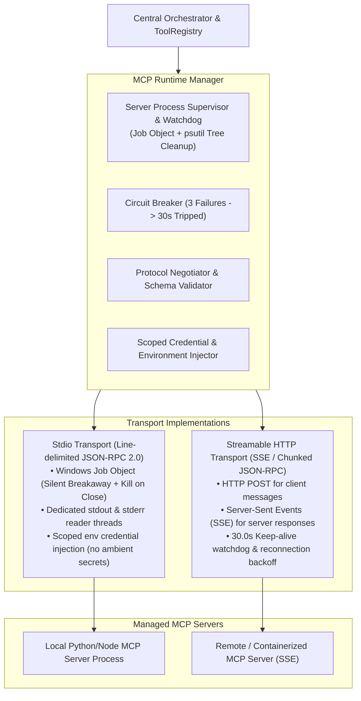
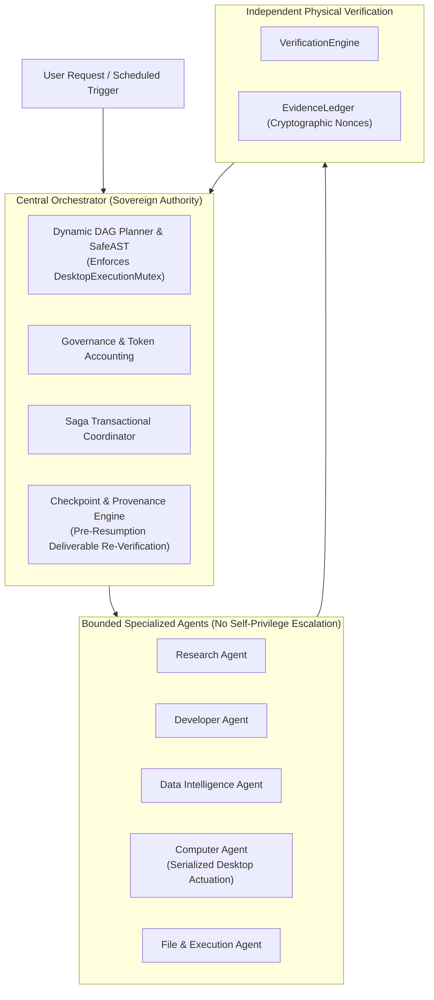
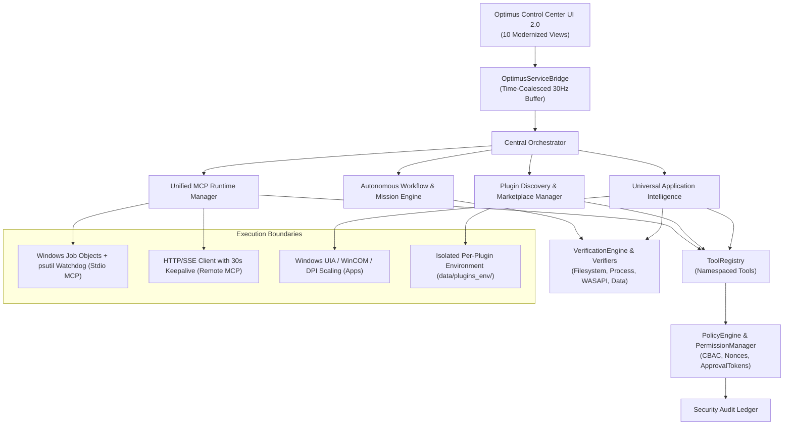

# OPTIMUS — Unified Intelligence & Extensibility Milestone
## Ratified Architecture Specification & Reconciled Systems Design

**Author:** Principal Software Architect, Senior Autonomous Systems Engineer, & Security Engineer  
**Date:** 2026-11-24  
**Project:** OPTIMUS — Autonomous Personal Agentic AI Assistant  
**Repository Working Directory:** `D:\project\srrr\Mark-LVII-main\Mark-LVII-main`  
**Authoritative Environment:** `D:\project\optimus\.venv\Scripts\python.exe` (Python 3.13.16)  
**Branch:** `main`  
**Review Status:** **RATIFIED** (Reconciled with Independent Goldfish Audit Findings CRIT-01..03, HIGH-01..05, MED-01..04, LOW-01..02)

---

## 1. Executive Overview & Baseline Architecture Assessment

OPTIMUS has evolved through multiple milestones (M11–M20, Performance Optimization, Visual Task Verification, UI 2.0, and Universal Mission Intelligence). While each milestone addressed critical discrete capabilities (such as local credential encryption, Direct3D 11 hardware-accelerated UI rendering, closed-loop WASAPI audio verification, and typed agent input/output contracts), these capabilities currently operate with distinct boundaries:

1. **Plugins vs. MCP Integrations:** Native plugins are loaded via `core/plugin_loader.py` with static AST screening and CapabilityTier mapping. Meanwhile, workspace MCP servers are handled separately via `core/workspace_mcp/` without a generalized multi-server runtime, streamable HTTP transport, or remote marketplace discovery.
2. **Application Intelligence:** The 7-tier interaction hierarchy in `core/application_intelligence/` (`TIER_1_NATIVE_API` through `TIER_7_VISUAL_ACTUATION`) and UFO² HostAgent/AppAgent integration operate effectively, but lack a formalized 9-stage lifecycle (`DISCOVER` → `IDENTIFY` → `INSPECT` → `PLAN` → `AUTHORIZE` → `ACT` → `OBSERVE` → `VERIFY` → `RECOVER`) with unified evidence tokens and strict non-reversible action barriers.
3. **Workflow & Mission Intelligence:** The newly introduced `DynamicDAGPlanner`, `SagaCoordinator`, and `MissionExecutionEngine` provide resilient DAG execution. However, they must be fully unified with the declarative `WorkflowEngine` (`core/workflows/engine.py`), workflow learning from application trajectories, and persistent checkpoint restoration.
4. **User Interface 2.0:** The Control Center provides 20 lazy-instantiated sections. The UI requires visual modernization to elevate 10 primary operational views with the midnight navy palette, fluid 50 tps streaming, responsive telemetry, and dedicated Marketplace / MCP Server management surfaces.

This milestone unifies these five systems into a cohesive, secure, local-first architecture without rewriting functioning subsystems or introducing fragile mock shortcuts.

---

## 2. Invariants & Security Architecture

All five capabilities must strictly adhere to the following non-negotiable security and operational invariants:

1. **Local-First & Scoped Credential Injection (Resolves CRIT-01, CRIT-02):** Credentials reside strictly in the OS Keyring (Windows Credential Manager) or the machine-bound Fernet encrypted vault (`config/.vault.enc`). MCP child processes and plugins never inherit ambient environment tokens (`GEMINI_API_KEY`, etc. are scrubbed from default env). Instead, credentials are explicitly injected per-server into a minimal, scoped `env` dictionary (`SYSTEMROOT`, `PATH`, `TEMP` + server-declared secrets) or via stream headers, maintaining strict protocol compatibility with third-party MCP servers.
2. **Out-of-Process Execution for Untrusted Marketplace Items (Resolves CRIT-01):** Third-party plugins discovered from external marketplaces (PyPI, GitHub, Smithery, Glama) are **strictly forbidden** from running in-process via `importlib`. All marketplace integrations run out-of-process as MCP servers or isolated worker subprocesses. In-process `NATIVE_PYTHON_PLUGIN` execution is restricted exclusively to first-party built-in plugins bundled within the immutable repository or verified with an operator cryptographic signature.
3. **Untrusted Metadata Boundary & SSRF Hardening (Resolves HIGH-04):** All external content—including marketplace search results, repository READMEs, MCP tool descriptions, and application UI text—is classified as untrusted input. Payloads are encapsulated inside cryptographically nonced XML tags (`<untrusted_data source="..." nonce="...">`) with HTML entity escaping before entering LLM contexts. All discovery HTTP requests pass through an SSRF-hardened transport resolving hostnames and blocking private, loopback, or link-local IP addresses (`127.0.0.0/8`, `10.0.0.0/8`, `172.16.0.0/12`, `192.168.0.0/16`, `169.254.0.0/16`, `::1`).
4. **Fail-Closed Central Authorization:** External tools, plugins, and MCP servers cannot approve their own operations. High-risk operations (mutating filesystem changes outside authorized workspaces, command execution, process termination, payments, communication transmissions) require authentic `ApprovalToken` challenges issued by `PolicyEngine` and signed by human confirmation.
5. **Independent Physical Verification (Anti-Hallucination):** No operation is considered completed on the basis of LLM self-reporting or tool return codes alone. Independent physical verifiers (`FilesystemVerifier`, `ProcessVerifier`, `MediaPlaybackVerifier`, `DataVerifier`) inspect actual OS state, disk bytes, active WASAPI audio sessions, and window handles.
6. **Irreversible Action Guardrail:** Actions categorized as non-idempotent or irreversible (sending emails/messages, deleting files, executing financial operations) are strictly barred from automatic retries after ambiguous outcomes (`AMBIGUOUS_EXECUTION`).
7. **Windows Job Object Process Isolation & Watchdog (Resolves HIGH-01):** Every subprocess spawned by the Unified MCP Runtime is bound to a dedicated Windows Job Object configured with both `JOB_OBJECT_LIMIT_KILL_ON_JOB_CLOSE` (0x2000) and `JOB_OBJECT_LIMIT_SILENT_BREAKAWAY_OK` (0x10). A background process tree watchdog (`psutil`) acts as fallback to ensure complete cleanup even if running within restricted nested job environments.
8. **Desktop Input Serialization (Resolves CRIT-03):** Desktop actuation (TIER_3 to TIER_7) operates against a single shared OS input queue. All UI-mutating subtasks are barred from concurrent execution (`parallelizable=False` enforced at planner level) and must acquire an exclusive `DesktopExecutionMutex`.

---

## 3. Subsystem 1: Plugin Discovery, Intelligence & Marketplace Architecture

### 3.1 Multi-Source Discovery Engine
The discovery engine interacts with five external sources via authenticated or public read-only APIs:
- **Official MCP Registry:** Canonical catalog of Model Context Protocol servers.
- **GitHub Repositories:** Topics `mcp-server`, `optimus-plugin`, and release tags.
- **Glama & Smithery:** Specialized MCP ecosystem indexing registries.
- **PyPI:** Python packages declaring entry points or metadata tags for `optimus.plugins`.

```mermaid
flowchart LR
    subgraph Sources["External Discovery Sources (Untrusted)"]
        MCPReg["Official MCP Registry"]
        GH["GitHub API"]
        Glama["Glama Registry"]
        Smithery["Smithery Registry"]
        PyPI["PyPI JSON API"]
    end

    subgraph DiscoveryEngine["Plugin Discovery & Intelligence Engine"]
        Crawler["SSRF-Hardened Discovery Harvester\n(Blocks 127.0.0.1, 169.254.0.0/16, RFC1918)"]
        Normalizer["Schema Normalizer & Metadata Extractor"]
        SecurityScanner["Static AST & Package Scanner\n(Checks Zip-Slip & Build Hooks)"]
        DupDetector["Duplicate & Native Equivalency Engine"]
        TrustGate["Untrusted Metadata Delimiter & Nonce Tagger"]
    end

    subgraph Storage["Marketplace Ledger"]
        PluginDB[("Local Plugin Registry & Cache\n(config/marketplace_cache.json)")]
    end

    Sources --> Crawler
    Crawler --> Normalizer
    Normalizer --> SecurityScanner
    SecurityScanner --> DupDetector
    DupDetector --> TrustGate
    TrustGate --> PluginDB
```



### 3.2 Plugin Intelligence & Security Categorization
For each discovered item, the engine calculates a structured descriptor:
- **Metadata:** Name, description, repository URL, maintainer, release tag, license (SPDX parsed).
- **Execution Type:** `MCP_SERVER` (stdio or HTTP) vs. `ISOLATED_CLI_PLUGIN` vs. `BUILTIN_NATIVE_PLUGIN` (Resolves CRIT-01).
- **Capability Tier & Permissions:** Explicitly requested permissions (`READ_ONLY`, `WORKSPACE_WRITE`, `EXECUTION`, `SYSTEM_MUTATING`, `NETWORK_EXTERNAL`).
- **Network & Filesystem Scope:** Hostname whitelists, allowed directory roots.
- **Security Assessment:** Static AST risk scan score, typosquatting probability (Levenshtein distance against core tools and popular packages), dependency vulnerability scan, license compatibility check (GPL vs. MIT vs. Apache-2.0), Zip-Slip archive path escape validation, and prohibition of dynamic build hooks.
- **Native Capability Equivalency:** Cross-referenced against `UniversalCapabilityRegistry` to flag existing equivalent built-in tools (e.g. flagging a 3rd-party "file-search" server when native `find_files` exists).

### 3.3 Installation Lifecycle & Hermetic Environments (Resolves MED-01)
The lifecycle transitions strictly through audited gates:
```
DISCOVERED → INSPECTED → REVIEWED → INSTALLED → TESTED → ENABLED
                ↓           ↓           ↓          ↓
             REJECTED    BLOCKED      FAILED     DISABLED / UPDATE_AVAILABLE / REMOVED
```
1. **DISCOVERED:** Catalog metadata retrieved, cached, and sanitized via SSRF-hardened client.
2. **INSPECTED:** Dependencies resolved; static source/package inspection conducted without executing code. Archives screened for Zip-Slip traversal (`../`).
3. **REVIEWED:** Security warnings, permissions, and network requirements surfaced to operator.
4. **INSTALLED:** Installed into a dedicated per-plugin isolated environment (`data/plugins_env/<plugin_id>/`) using `uv` or hermetic venvs, preventing dependency version collisions.
5. **TESTED:** Automated sandbox health check (JSON-RPC ping / capability handshake) verifies clean initialization within 5.0s timeout.
6. **ENABLED:** Registered into `ToolRegistry` and Central Orchestrator under authorized capability tiers.

---

## 4. Subsystem 2: Unified MCP Runtime Architecture

### 4.1 Transport Layer: Stdio & Streamable HTTP (Resolves CRIT-02, MED-02, LOW-02)
The unified MCP runtime supports two production-grade transports adhering to the canonical Model Context Protocol (2024-11-05 revision):



### 4.2 Supervised Lifecycle & Reliability
- **Protocol Handshake & Capability Negotiation:** Handles `initialize`, `notifications/initialized`, `tools/list`, `resources/list`, and `prompts/list`.
- **Tool Schema Validation:** Tool schemas are validated via `jsonschema` before registration to prevent parameter confusion.
- **Request Correlation & Timeouts:** Atomic request ID counter with monotonic timeout tracking (default 10.0s). Cancellation tokens issue `notifications/cancelled` to the server if the client aborts. Dedicated reader threads for both stdout and stderr prevent OS pipe deadlocks.
- **Circuit Breaker:** Tracks consecutive failures per server. 3 consecutive timeouts/crashes trip the circuit breaker into `TRIPPED` state for 30 seconds, preventing cascade failure loops in the orchestrator.
- **SSE Keep-Alive Watchdog (Resolves MED-02):** Active watchdog monitors SSE streams; if no frame or keepalive comment is observed in 30.0s, the client terminates the stream and initiates backoff reconnection.

### 4.3 PolicyEngine & CBAC Tool Registration
Every MCP tool is registered into `ToolRegistry` with a server namespace prefix (e.g. `mcp__<server_id>__<tool_name>`).
- The `PolicyEngine` enforces capability tier boundaries based on the server's declared trust tier.
- Tool outputs exceeding 64KB are automatically truncated or spilled to disk artifacts.
- Outputs are tagged with taint metadata and nonce delimiters to resist indirect prompt injection.

---

## 5. Subsystem 3: Universal Application Intelligence Enhancements

### 5.1 The 9-Stage Closed-Loop Interaction Lifecycle (Resolves MED-03)
All interactions with desktop applications follow the unified lifecycle:

```
DISCOVER → IDENTIFY → INSPECT → PLAN → AUTHORIZE → ACT → OBSERVE → VERIFY → RECOVER
```

1. **DISCOVER:** Detect installed and running applications across system drives, Start Menu, Registry, and UWP packages (`ApplicationDiscovery`).
2. **IDENTIFY:** Determine target window, HWND, PID, process integrity level (`Low`, `Medium`, `High`/Admin), UIPI elevation status, High-DPI coordinate scaling, and active browser tab.
3. **INSPECT:** Read UI Automation element hierarchy or DOM tree with caching and depth limits (avoiding deep recursive hangs).
4. **PLAN:** Select optimal execution tier: `TIER_1_NATIVE_API` → `TIER_2_ADAPTER` → `TIER_3_UI_AUTOMATION` → `TIER_4_BROWSER_DOM` → `TIER_5_UFO_DESKTOP_AGENT` → `TIER_7_VISUAL_ACTUATION`.
5. **AUTHORIZE:** Acquire `DesktopExecutionMutex` and `DesktopInteractionLock` to prevent human/agent and inter-subtask input collisions (Resolves CRIT-03). Check `PolicyEngine` for high-risk operations.
6. **ACT:** Execute actuation (WinCOM API, UIA invoke/value pattern, synthetic input with DPI correction, or browser CDP command).
7. **OBSERVE:** Capture post-action UI state digest, active window title, and process telemetry.
8. **VERIFY:** Execute independent postcondition verifier (`FilesystemVerifier`, `ProcessVerifier`, `MediaPlaybackVerifier`, `DataVerifier`). Formulate evidence verdict using `ExecutionVerdict(str, Enum)`:
   - `COMPLETED_VERIFIED`: Physical criteria conclusively met.
   - `COMPLETED_WITH_LIMITATIONS`: Primary objective achieved, minor non-critical assertion skipped.
   - `ACTION_EXECUTED_UNVERIFIED`: Tool executed without errors, but independent verification target was unobservable.
   - `FAILED`: Explicit error, crash, or postcondition assertion violated.
   - `BLOCKED`: Blocked by UIPI admin elevation, modal dialog, or security gate.
   - `CANCELLED`: Aborted cooperatively by user.
9. **RECOVER:** If failed, diagnose failure cause. If idempotent, retry with secondary tier; if non-idempotent/irreversible, halt and escalate.

### 5.2 Browser Tab & Window Intelligence
- **Active Tab Resolution:** Inspects browser top-level windows (Chrome, Edge, Firefox, Brave) using accessibility and window titles to track current URL and tab count without attaching heavy debuggers.
- **UIPI Shielding:** Pre-screen application token integrity levels. Attempting to actuate an elevated Administrator window from a standard integrity process triggers an immediate `BLOCKED (UIPI_BARRIER)` verdict with clear guidance rather than hanging silently.
- **UFO² Trajectory Integration:** Learned trajectories from Microsoft UFO² multi-app runs are quarantined as `UNVERIFIED` in `WorkflowStore` until reviewed and promoted by the operator.

---

## 6. Subsystem 4: Autonomous Workflow Intelligence Architecture

### 6.1 Unified Hierarchical Orchestration
The Central Orchestrator maintains sovereign authority over planning, governance, and verification, delegating specific subtasks to specialized agents under strict contracts:



### 6.2 Advanced Execution Capabilities (Resolves CRIT-03, HIGH-03, HIGH-05)
- **Dependency-Aware Scheduling & Skip Propagation:** Evaluates dependency DAGs in topological waves. If upstream conditional branches skip, dependent nodes cascade skip without creating deadlocks (`ALL_RESOLVED` vs. `ONE_COMPLETED` join policies). Fallback expressions (e.g. `{{ steps.A.output | default('fallback') }}`) are evaluated; unresolvable missing inputs automatically cascade skip to avoid `KeyError` crashes.
- **Controlled Parallel Waves & Desktop Serialization:** Subtasks marked `parallelizable=True` execute concurrently up to `max_concurrent_workers = 4`. All UI-mutating subtasks are strictly serialized via `DesktopExecutionMutex`.
- **Pre-Resumption Deliverable Re-Verification:** Resuming an interrupted mission re-verifies all upstream deliverables on disk against physical verifiers. Any missing deliverable forces DAG rollback and re-queueing of the producing subtask.
- **Loop & Oscillation Detection:** `SemanticLoopDetector` computes structural AST/tool call signatures, filters out dynamic timestamps and nonces, and halts on repetitive 3x failure loops or sliding n-gram oscillations.

---

## 7. Subsystem 5: Advanced Visual UI Modernization

### 7.1 Design Tokens & Thematic Architecture (Resolves HIGH-02, LOW-01)
Building upon the Direct3D 11 hardware-accelerated RHI foundation established in UI 2.0 (`104a7db`):
- **Primary Surface Palette:** Deep midnight navy (`#080c14` base background, `#0e1626` panels, `#162238` active surfaces).
- **Accents & WCAG Contrast Compliance:** Large headers & borders use electric blue (`#0084ff`); body text, telemetry values, and labels strictly use cyan (`#00d4ff`, 8.5:1 ratio) or off-white (`#e2e8f0`, 13:1 ratio) to exceed WCAG 2.2 AA (4.5:1 requirement).
- **Time-Coalesced Streaming Ring-Buffer:** Ingested LLM tokens are buffered in a thread-safe deque and flushed to `QTextDocument` via a 30Hz/60Hz `QTimer` (16ms–33ms), preventing main event-loop choking under 50 tps streaming.
- **Transitions:** Bounded frame rates, hardware V-Sync synchronization, zero redundant widget rebuilds.

### 7.2 Modernization of 10 Core Views
1. **Command Center:** Omnibar for natural language objective input, quick action buttons, live execution status badge.
2. **Conversation Interface:** Continuous 50 tps streaming via coalescing ring-buffer, Markdown rendering with copy controls, expandable thought/reasoning sections.
3. **Plugin Marketplace:** Dedicated catalog browser with category filters (Data, Automation, Cloud, Developer, Communication), search omnibar, security assessment scorecards, single-click install/update.
4. **MCP Server Manager:** Real-time list of configured stdio and HTTP MCP servers, transport diagnostics, latency meters, discovered tools table, circuit-breaker reset toggles.
5. **Application Intelligence:** Discovered application grid, active window indicators, integrity level badges, manual actuation tester, learned workflow manager.
6. **Workflow Visualizer:** Interactive DAG graph renderer showing subtask states (Pending, Running, Completed, Skipped, Failed), execution timing, and variable bindings.
7. **Mission Monitoring:** Active and historical mission ledger, live progress indicators, subtask timeline events, token consumption gauge.
8. **Verification Evidence Viewer:** Cryptographic evidence ledger viewer, raw filesystem/process/audio checks, tamper-evident SHA-256 integrity hash verification.
9. **Agent Activity Monitor:** Specialized agent roster (`researcher`, `developer`, `computer`, etc.), active turn indicators, allowed capability tiers, per-agent token accounting.
10. **Provider & Integration Management:** Inference providers (NVIDIA NIM, Gemini, Ollama, LM Studio), Google Workspace MCP credentials status, host telemetry meters (CPU, RAM, GPU VRAM, thermals).

---

## 8. Subsystem Dependency Map & Integration Boundaries



---

## 9. Comprehensive Adversarial Test Strategy (Phase 7 Suite: 85 Tests)

The dedicated test suite `tests/adversarial_milestone/` will be built from scratch to rigorously stress all security invariants, protocol parsers, error recovery paths, and concurrency limits across 85 adversarial test cases (Resolves MED-04):

### Category A: Plugin Discovery & Installation Security (18 Tests)
- `test_a01_prompt_injection_in_repo_metadata`: Rejection/neutralization of injection attempts in description/README.
- `test_a02_malicious_readme_instruction_demarcation`: Taint encapsulation of untrusted markdown instructions.
- `test_a03_dependency_confusion_detection`: Detection of public vs. internal conflicting package names.
- `test_a04_package_name_impersonation`: Rejection of homoglyphs and impersonated official namespaces.
- `test_a05_typosquatted_package_warning`: Warning raised for high Levenshtein similarity to core tools.
- `test_a06_malicious_setup_script_block`: Prohibition of arbitrary setup.py code execution during inspection.
- `test_a07_dependency_version_conflicts`: Clean conflict reporting without polluting root virtualenv.
- `test_a08_revoked_or_invalid_release_hash`: Integrity SHA-256 mismatch halts installation.
- `test_a09_license_incompatibility_detection`: GPL vs. proprietary license flag raised.
- `test_a10_duplicate_plugin_installation_blocked`: Rejection of duplicate registrations with identical IDs.
- `test_a11_partial_installation_rollback`: Failure during install triggers atomic directory removal.
- `test_a12_tampered_package_integrity`: Modified package bytes detected before registration.
- `test_a13_unauthorized_permission_escalation`: Plugin requesting ungranted tier blocked by PolicyEngine.
- `test_a14_plugin_disabling_during_active_mission`: Disabling plugin prevents subsequent invocations gracefully.
- `test_a15_plugin_execution_timeout_enforced`: 30.0s hard timeout halts runaway plugin execution.
- `test_a16_secret_leakage_redaction`: Sensitive keys in plugin error output scrubbed by `redact_secret`.
- `test_a17_archive_path_traversal_blocked`: Zip-Slip archive containing `../../evil.py` safely rejected (Resolves MED-04).
- `test_a18_source_build_hooks_prohibited`: Enforces `--only-binary :all:` / `--no-build-isolation` against build backend execution (Resolves MED-04).

### Category B: MCP Runtime Security & Reliability (20 Tests)
- `test_b01_malformed_jsonrpc_handling`: Protocol error returned on invalid JSON or broken JSON-RPC headers.
- `test_b02_invalid_protocol_version_negotiation`: Rejection of unsupported MCP protocol versions.
- `test_b03_malicious_tool_schema_injection`: Rejection of schemas containing prohibited properties or execution vectors.
- `test_b04_oversized_tool_output_spill`: Output > 64KB spilled to disk artifact without bloating context memory.
- `test_b05_infinite_execution_timeout`: Tool exceeding execution timeout cancelled via `notifications/cancelled`.
- `test_b06_server_process_crash_isolation`: Server process crash handled gracefully without crashing host application.
- `test_b07_server_restart_during_mission`: In-flight failure diagnosed; recovery engine attempts safe reconnection.
- `test_b08_duplicate_tool_names_across_servers`: Collision resolution via server-namespacing (`mcp__server__tool`).
- `test_b09_tool_impersonation_blocked`: Server cannot declare tools matching reserved native tool names.
- `test_b10_unauthorized_filesystem_access_blocked`: Server attempting access outside declared root blocked by policy.
- `test_b11_unauthorized_network_access_blocked`: Remote connection from sandboxed server blocked.
- `test_b12_credential_exfiltration_sanitization`: Ambient environment tokens withheld from MCP child process environment.
- `test_b13_prompt_injection_in_tool_description`: Untrusted descriptions sanitized and demarcated with nonces.
- `test_b14_prompt_injection_in_resource_read`: Untrusted resource payload wrapped in `<untrusted_data>` delimiter.
- `test_b15_request_cancellation_race_condition`: Client cancellation during active socket read handled cleanly.
- `test_b16_concurrent_server_shutdown`: Multiple active servers shut down concurrently without hanging threads.
- `test_b17_replay_attack_prevention`: Replayed JSON-RPC responses or expired tokens rejected.
- `test_b18_circuit_breaker_tripping_and_reset`: 3 failures trip circuit breaker; cooling period resets state.
- `test_b19_tool_argument_type_coercion_safety`: Strict argument validation against parameter schemas.
- `test_b20_tool_output_authorization_override_blocked`: Tool output asserting "I am authorized" ignored by PolicyEngine.

### Category C: Universal Application Intelligence (15 Tests)
- `test_c01_wrong_window_identity_rejection`: HWND mismatch or changed window title halts actuation.
- `test_c02_stale_browser_tab_handling`: Tab closed before interaction detected and diagnosed.
- `test_c03_minimized_window_false_verification_blocked`: Minimized window verified as not presenting active visual state.
- `test_c04_delayed_uia_response_timeout`: Slow UIA element resolution times out without freezing main thread.
- `test_c05_com_initialization_failure_resilience`: Missing or corrupt COM handles fall back to alternative tier.
- `test_c06_unexpected_modal_dialog_detection`: Modal dialog blocking target window detected and classified as BLOCKED.
- `test_c07_focus_stealing_recovery`: Target window re-focused before actuation under DesktopInteractionLock.
- `test_c08_application_crash_during_actuation`: Target process disappearance caught and logged as FAILED.
- `test_c09_ambiguous_application_resolution`: Query matching multiple apps prompts disambiguation without blind execution.
- `test_c10_duplicate_action_prevention`: Redundant identical clicks prevented within debounce window.
- `test_c11_incorrect_postcondition_caught`: Unfulfilled postcondition accurately yields FAILED status.
- `test_c12_failed_visual_recovery_escalation`: Exhausted visual fallbacks escalate to user intervention.
- `test_c13_untrusted_ui_text_injection_neutralized`: Malicious on-screen text treated as untrusted data.
- `test_c14_recovery_after_application_restart`: Relaunched application re-binds HWND and resumes execution.
- `test_c15_high_dpi_coordinate_normalization`: Multi-monitor 125%/150% DPI scaling properly normalized (Resolves MED-04).

### Category D: Autonomous Workflow Intelligence (19 Tests)
- `test_d01_cyclic_dependency_rejected`: Graph cycle detected by Tarjan/DFS algorithm and rejected.
- `test_d02_invalid_delegation_blocked`: Agent attempting to delegate to non-existent specialist rejected.
- `test_d03_malicious_subtask_instruction_taint`: Untrusted subtask instructions tagged with security nonce.
- `test_d04_agent_permission_escalation_blocked`: Agent executing tool outside allowed tiers denied by PolicyEngine.
- `test_d05_conflicting_worker_outputs_reconciled`: Join policy resolves conflicting parallel branch outputs.
- `test_d06_worker_timeout_recovery`: Subtask timeout triggers recovery engine replanning.
- `test_d07_mission_interruption_checkpointing`: Interrupted execution state saved with complete deliverable provenance.
- `test_d08_concurrent_mission_updates_locked`: Concurrent state mutations serialized by MissionRecord RLock.
- `test_d09_duplicate_deliverable_idempotency`: Existing verified deliverable prevents duplicate work.
- `test_d10_false_completion_claim_caught`: LLM claiming success without verified deliverable rejected.
- `test_d11_missing_provenance_flagged`: Deliverable without trace to originating subtask flagged.
- `test_d12_recovery_from_partially_completed_mission`: Interrupted run resumes from last unverified subtask.
- `test_d13_cancellation_race_condition`: Immediate cancellation during active execution joins threads cleanly.
- `test_d14_resource_budget_exhaustion_halt`: Token accounting governor halts execution upon budget breach.
- `test_d15_infinite_delegation_depth_blocked`: Maximum delegation depth limit (depth > 3) halts run.
- `test_d16_repetitive_failure_loop_halt`: SemanticLoopDetector halts periodic or identical failure cycles.
- `test_d17_irreversible_action_not_retried`: Non-idempotent action failure prevents automated replay.
- `test_d18_stale_checkpoint_restoration_rejected`: Checkpoint with mismatched hash or altered state rejected.
- `test_d19_pre_resumption_deliverable_re_verification`: Upstream deliverable disappearance forces DAG rollback (Resolves HIGH-05).

### Category E: UI & Runtime Stability (13 Tests)
- `test_e01_continuous_streaming_throughput`: 50 tps streaming maintains responsive event loop latency (< 16ms).
- `test_e02_concurrent_telemetry_updates`: High-frequency sensor updates process without UI freezing.
- `test_e03_rapid_view_navigation_stability`: Cycling rapidly between all 20 views incurs zero leaks or crashes.
- `test_e04_repeated_window_resize_layout_stability`: Dynamic resizing maintains aspect ratios and responsive layouts.
- `test_e05_background_worker_clean_shutdown`: Closing window stops and joins all active telemetry/worker threads.
- `test_e06_bounded_memory_under_prolonged_streaming`: Memory growth remains bounded (< 20MB delta) during 1000 chunks.
- `test_e07_high_volume_log_ingestion`: 10,000 log events ingested without buffer overflow or UI lockup.
- `test_e08_plugin_installation_progress_signals`: UI progress bar receives accurate lifecycle state events.
- `test_e09_mcp_server_disconnect_ui_resilience`: Dropped MCP connection updates UI status badge gracefully.
- `test_e10_workflow_cancellation_ui_update`: Cancelled workflow updates DAG visualizer state immediately.
- `test_e11_reduced_motion_accessibility_compliance`: Reduced-motion setting disables animations cleanly.
- `test_e12_high_contrast_theme_compliance`: Midnight navy theme satisfies WCAG 2.2 AA contrast ratios (> 4.5:1).
- `test_e13_time_coalesced_token_ring_buffer`: Ingested tokens dispatched at 30Hz/60Hz batches without UI lag (Resolves HIGH-02).

**Total Planned Adversarial Tests:** 18 + 20 + 15 + 19 + 13 = **85 Tests**.

---

## 10. Implementation Sequence & Deliverables

1. **Phase 2 — Plugin Discovery & Marketplace Subsystem:**
   - `core/marketplace/sources.py`: SSRF-hardened discovery harvester for MCP Registry, GitHub, Glama, Smithery, PyPI.
   - `core/marketplace/scanner.py`: AST scanner, typosquatting detector, license validator, Zip-Slip inspector.
   - `core/marketplace/installer.py`: Isolated virtualenv installer (`data/plugins_env/<id>/`).
   - `core/marketplace/manager.py`: Complete lifecycle manager (`DISCOVERED` .. `ENABLED`).
2. **Phase 3 — Unified MCP Runtime Subsystem:**
   - `core/mcp_runtime/transports/stdio.py`: Stdio transport with Windows Job Objects (`KILL_ON_CLOSE` + `SILENT_BREAKAWAY`) and dedicated stdout/stderr threads.
   - `core/mcp_runtime/transports/http_sse.py`: Streamable HTTP/SSE transport with 30s keep-alive watchdog and reconnection backoff.
   - `core/mcp_runtime/supervisor.py`: Process supervisor, health check, circuit-breaker (3 trips -> 30s cooldown).
   - `core/mcp_runtime/manager.py`: Central MCP server manager registering tools into `ToolRegistry` and `PolicyEngine`.
3. **Phase 4 — Universal Application Intelligence Enhancements:**
   - `core/application_intelligence/lifecycle.py`: 9-stage closed-loop interaction manager.
   - `core/application_intelligence/types.py`: Extended with `ExecutionVerdict(str, Enum)`.
   - `core/application_intelligence/dpi.py`: Windows High-DPI coordinate scaling normalization.
   - `core/application_intelligence/ufo_integrator.py`: UFO² trajectory converter quarantining workflows as `UNVERIFIED`.
4. **Phase 5 — Autonomous Workflow Intelligence:**
   - `core/workflows/engine.py` & `core/missions/engine.py`: Coordinated dynamic DAG execution with `DesktopExecutionMutex` serialization.
   - `core/workflows/checkpointing.py`: Checkpoint persistence with pre-resumption deliverable re-verification.
5. **Phase 6 — Advanced Visual UI Modernization:**
   - `gui/optimus/service_bridge.py`: Coalesced token ring-buffer (30Hz/60Hz QTimer flushing).
   - `gui/optimus/section_marketplace.py`: Dedicated Plugin Marketplace UI.
   - `gui/optimus/section_mcp_manager.py`: Dedicated MCP Server Manager UI.
   - Modernized styling and telemetry across all 10 core views.
6. **Phase 7 — Adversarial Milestone Test Suite:**
   - `tests/adversarial_milestone/`: 85 rigorous tests covering Categories A through E with local fixtures.
