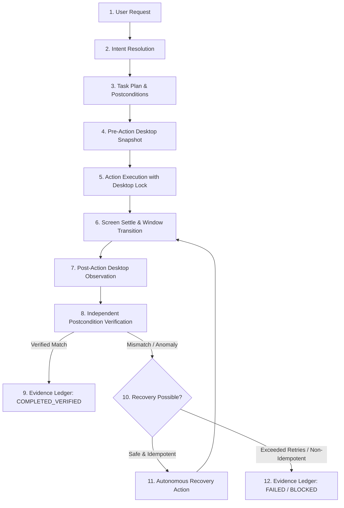

# OPTIMUS Elephant Architecture Investigation: Autonomous Computer Operation & Visual Task Verification

**Milestone:** Priority 0 — Universal Visual Task Verification & Closed-Loop Autonomous Operation  
**Authoritative Repository:** `D:\project\srrr\Mark-LVII-main\Mark-LVII-main`  
**Target Environment:** Python 3.13.16 (Windows 11 AMD64, 16 Cores, 16 GB RAM)  
**Baseline Commit:** `ca89686`  
**Investigator:** Elephant Architectural Auditor  

---

## 1. Context & Problem Statement

A fundamental flaw exists across current desktop AI agents, including previous iterations of OPTIMUS:
> **Actions are executed, but the system cannot independently verify whether those actions actually succeeded in the real desktop environment.**

Prior milestones (M16 Visual Awareness, M17 Application Intelligence, M18 Framework Integration, M19 UFO² Desktop Agent) introduced core capabilities:
- Screen capture via `mss` and perceptual difference hashing (`dHash`).
- Window discovery and focus management via Win32 `AttachThreadInput`.
- Browser tab enumeration via UI Automation and title regex heuristics.
- Interaction routing through a 5-tier ladder (Native API → Dedicated Adapter → UI Automation → Browser DOM → Visual Actuation).
- Physical verification in `core/verification/` for files, processes, JSON data, and command exit codes.

However, an adversarial inspection of the codebase reveals that **end-to-end task outcome verification is largely simulated, heuristic, or absent**:
1. When `InteractionRouter` clicks a UI button via `core.screenact.click(element)`, it checks `if act_res.ok` (which merely indicates Windows accepted the mouse event) and immediately returns `status="done"`.
2. When `BrowserAdapter.execute()` handles `navigate`, it calls `webbrowser.open(url)`, sleeps 0.5s, and unconditionally returns `evidence_data={"navigation_verified": True}` without inspecting whether a browser window appeared, which tab loaded, or if the page encountered a `404` or `ERR_NAME_NOT_RESOLVED`.
3. When `AutonomousTaskSupervisor.supervise_step()` checks a transition, if no crash or unexpected dialog is detected, it generates a synthetic SHA-256 hash `ev_vis_...` and returns `is_successful=True` with `actual_state="State transition verified visually"`, even if the screen merely showed a blinking cursor or an infinite loading spinner.
4. When `MREOutcomeVerifier.verify()` checks `process_running` or `window_focused`, it returns `True` as long as the underlying tool call did not raise an exception.
5. In `core/verification/types.py`, `PostconditionType` defines only `FILESYSTEM`, `PROCESS`, `DATA`, and `COMMAND`. There are **no postcondition types for desktop windows, browser page states, UI element recognition, or media playback**.

---

## 2. Capability Audit: Operational vs. Heuristic vs. Simulated

| Component | File Path | Current Status | Ground Truth Reality |
|---|---|---|---|
| **Screen Observer** | `core/vision/screen_observer.py` | **Operational** | Continuous capture via `mss`, dHash computation, multi-monitor discovery, privacy masking. Reliable for frame diffing, but purely passive. |
| **Window Intelligence** | `core/vision/window_intelligence.py` | **Operational** | Reliable Win32 `EnumWindows`, `AttachThreadInput` foreground activation, `SW_RESTORE` geometry management. Lacks window responsiveness/hang checks. |
| **Browser Intelligence** | `core/vision/browser_intelligence.py` | **Heuristic** | Discovers browser windows and UIA tabs. Omnibox active URL is reliably parsed when address bar is exposed; background tabs rely on domain heuristics from title string regex. Cannot verify DOM readiness or HTTP error states. |
| **Task Supervisor** | `core/vision/task_supervisor.py` | **Simulated / Stub** | Anomaly detection checks process crash and unexpected popup title. If screen dHash changes (`pre.dhash != post.dhash`), it blindly declares `is_successful=True` with a synthetic evidence ID, regardless of whether the requested action succeeded. |
| **Interaction Router** | `core/application_intelligence/interaction_router.py` | **Open-Loop** | Equates input delivery (`act_res.ok`) with task completion. Lacks post-action desktop observation and postcondition verification. |
| **Browser Adapter** | `core/application_intelligence/adapters/browser.py` | **Simulated / Heuristic** | Web search queries static mock dictionary; file downloads write simulated strings to disk; URL navigation sleeps 0.5s and claims `navigation_verified=True`. |
| **Verification Engine** | `core/verification/engine.py` | **Incomplete Scope** | Verifies files (`FilesystemVerifier`), PIDs (`ProcessVerifier`), JSON/data (`DataVerifier`), exit codes (`CommandVerifier`). Has **zero** verifiers for desktop UI, browser URLs, DOM state, or media playback. |
| **UFO² Mission Runner** | `core/application_intelligence/frameworks/ufo/mission_runner.py` | **Operational Gateway** | Bounded FastMCP execution with VRAM check. Lacks independent visual outcome postcondition auditing. |

---

## 3. The Closed-Loop Execution Architecture

To establish an autonomous computer-use system that never claims success without proof, OPTIMUS must execute all computer tasks through a closed loop:

### The 8 Universal Lifecycle States:
1. **REQUEST:** Natural language command or programmatic subtask.
2. **INTENT RESOLUTION:** Identification of target application, operation type, parameters, and explicit required physical postconditions.
3. **TASK PLAN:** Explicit sequence of actions paired with expected postcondition contracts.
4. **ACTION EXECUTION:** Execution through the appropriate tier under `DesktopInteractionLock`.
5. **DESKTOP OBSERVATION:** Independent multi-modal inspection (window state, UIA tree, Omnibox/URL, screen capture, process state).
6. **POSTCONDITION VERIFICATION:** Strict comparison of observed state against expected state by an independent verifier.
7. **RECOVERY IF NECESSARY:** Diagnosis of failure mode, safety evaluation, alternative action formulation, and bounded retries.
8. **FINAL RESULT:** Truthful reporting backed by cryptographic evidence records and explicit terminal statuses (`COMPLETED_VERIFIED`, `COMPLETED_WITH_LIMITATIONS`, `ACTION_EXECUTED_UNVERIFIED`, `FAILED`, `BLOCKED`, `CANCELLED`).

---

## 4. Verification Strategies Across Supported Operations

### 1. Application Launch & Focus
- **Precondition:** Target application executable identified.
- **Action:** Launch via registry or focus via Win32.
- **Observation:** Query Win32 `EnumWindows`, `GetForegroundWindow`, process tree, and `IsHungAppWindow`.
- **Postcondition Verification:** Target process PID is running AND at least one top-level visible window exists with HWND > 0 AND window title/class matches target AND window is responsive (not hung) AND window is active/foreground.

### 2. Website Navigation
- **Precondition:** Target URL normalized.
- **Action:** Open or navigate via browser adapter or OS shell.
- **Observation:** Query browser window HWND, enumerate accessible tabs via UIA, read Omnibox address bar value, look for page title, inspect UIA elements for navigation failure banners ("This site can't be reached", "ERR_NAME_NOT_RESOLVED", "404 Not Found").
- **Postcondition Verification:** Browser window is active AND active tab URL or domain matches expected destination AND page title matches expected site AND no network error banner is displayed.

### 3. YouTube Video Search & Playback
- **Precondition:** Requested topic or trailer title (e.g., "Doomsday trailer").
- **Action:** Navigate to YouTube, locate search box, enter query, inspect search results, select authoritative matching result, click to open.
- **Observation:** 
  1. *Search Page:* URL contains `youtube.com/results?search_query=...`, page elements contain video result cards with titles matching the query.
  2. *Watch Page:* URL contains `youtube.com/watch?v=...`, page title contains trailer/video title.
  3. *Playback State:* Video player element exists (`ytd-player` or video container). Video is actively playing verified via:
     - Player control shows "Pause" button (meaning video is playing; "Play" button indicates paused).
     - Progress bar / current time indicator is moving or > 0:00.
     - No blocking consent modal or sign-in gate obstructing video.
     - No playback error overlay ("Video unavailable", "This video is private").
- **Postcondition Verification:** Watch URL confirmed AND video title matches query AND playback state is confirmed active.

### 4. File Open & Content Verification
- **Precondition:** File path exists on disk.
- **Action:** Launch associated application with target file path.
- **Observation:** Check application process and active window title. Inspect UIA text edit controls or title bar.
- **Postcondition Verification:** Target application window exists AND window title contains the file's basename AND window is responsive.

### 5. Document Save & Persistence
- **Precondition:** Save operation triggered (e.g. `Ctrl+S`, file write).
- **Action:** Actuate save dialog or atomic file write.
- **Observation:** Stat filesystem path, check modification timestamp, compute SHA-256 checksum, verify non-empty byte count.
- **Postcondition Verification:** File exists at destination path AND `stat.st_mtime >= t_action_start` AND `stat.st_size > 0` AND content matches expected payload.

### 6. Browser Tab Switching
- **Precondition:** Target query or tab ID.
- **Action:** Invoke UIA tab selection or focus window.
- **Observation:** Enumerate browser tabs, inspect `is_active` flag, verify foreground window title and Omnibox.
- **Postcondition Verification:** Target tab `is_active == True` AND browser window is foreground.

---

## 5. Autonomous Recovery Protocol

When postcondition verification fails:
1. **Fresh Observation:** Capture fresh `DesktopState` and UIA tree snapshot.
2. **Failure Diagnosis:**
   - `WINDOW_NOT_FOUND`: Application failed to launch or crashed → Verify executable path, retry launch.
   - `WRONG_TAB_ACTIVE`: Browser opened background tab or wrong tab → Walk UIA tabs, find matching title/domain, trigger `SelectionItem.Select()`.
   - `NAVIGATION_ERROR`: Site unreachable or network error → Diagnose error string; report BLOCKED if offline.
   - `POPUP_OBSTRUCTION`: Unexpected modal/cookie banner blocking controls → Detect dialog, dismiss via ESC or "Accept"/"Close", re-verify.
   - `PLAYBACK_STALLED`: Video paused or stuck buffering → Locate player container, send Spacebar or click Play button, wait 2.0s, re-check playback time.
3. **Idempotency Gate:**
   - Read/Navigate/Focus actions: Idempotent → Safe to retry up to 2 times.
   - Send/Pay/Delete/Submit actions: Non-idempotent → **NEVER auto-retry**. Flag as `BLOCKED` and demand user confirmation.
4. **Terminal Escrow:** If retries are exhausted (max 2 attempts), record detailed failure evidence and set status to `FAILED`.

---

## 6. Structural & Architecture Recommendations

1. **New Postcondition Verifiers in `core/verification/`:**
   - `DesktopWindowVerifier`: Verifies window existence, HWND, responsiveness, and title patterns.
   - `BrowserPageVerifier`: Verifies browser active tab, URL, domain, and error-free loading.
   - `MediaPlaybackVerifier`: Verifies active audio/video playback state via player UI controls and time progress.
   - `UIControlVerifier`: Verifies specific UI elements, text, buttons, and state in the accessibility tree.
2. **Unified Task Verifier (`core/vision/task_verifier.py`):**
   A dedicated closed-loop task execution engine combining pre-action snapshots, post-action inspection, verification, and autonomous recovery.
3. **True Browser Adapter Operations (`core/application_intelligence/adapters/browser.py`):**
   Replace mock search dictionary and simulated downloads with genuine browser-driven navigation, real tab/URL inspection, and verified downloads.
4. **Structured Evidence Ledger (`core/verification/types.py`):**
   Expand verification statuses to include `COMPLETED_VERIFIED`, `COMPLETED_WITH_LIMITATIONS`, `ACTION_EXECUTED_UNVERIFIED`, `FAILED`, `BLOCKED`, `CANCELLED`.
5. **UI Status Surface:**
   Update `SectionVision` (`gui/optimus/section_vision.py`) and status bars to render live task execution, verification results, and evidence hashes.

---

*Investigation completed by Elephant Architectural Auditor. Ready for Independent Goldfish Review.*
