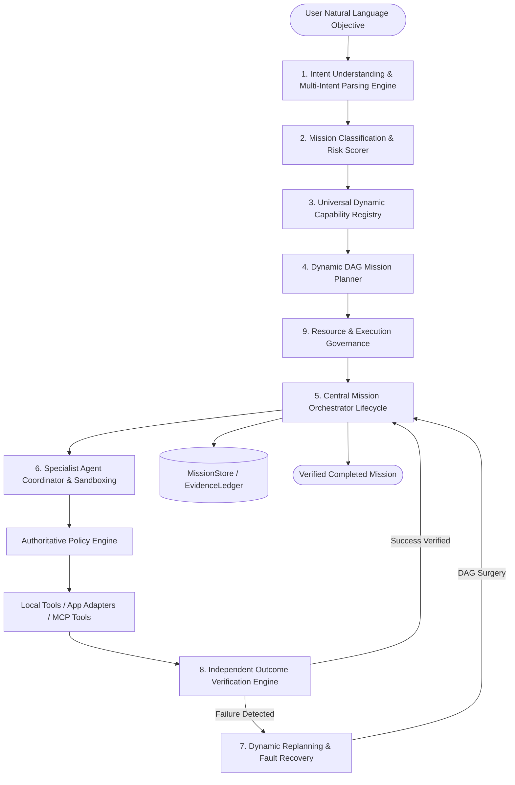

# OPTIMUS Universal Mission Intelligence & Dynamic Execution Engine — Target Architecture Specification

**Document Version:** 1.0.0  
**Status:** Under Architectural Review  
**Date:** 2026-11-24  
**Author:** Principal Systems Architect & Engineering Team  
**Repository:** `D:\project\srrr\Mark-LVII-main\Mark-LVII-main`  
**Git Base Commit:** `104a7db`  

---

## 1. System Vision & Architecture Overview

The **Universal Mission Intelligence & Dynamic Execution Engine** transforms OPTIMUS into an autonomous, mission-driven personal AI agent. It bridges user intent expressed in unstructured natural language with rigorous, deterministic, verified execution across local and network tools.



---

## 2. Component Specifications

### 2.1 Intent Understanding & Multi-Intent Parsing Engine (`core/missions/intent.py`)

#### Responsibilities
1. Parse complex, multi-clause, conversational requests into structured `ParsedIntent` models.
2. Decompose compound intents into sequential ("then", "after that") or parallel ("and simultaneously", "while") goals.
3. Extract named entities: paths, applications, URLs, process names, contact names, file extensions.
4. Normalize temporal expressions into absolute time windows (e.g. "last two days" -> `[now - 172800, now]`).
5. Extract constraints: read-only vs mutating, budget bounds, format requirements, directory boundaries.
6. Formulate explicit, testable completion criteria (e.g., `file_exists: "path"`, `playback_state: "playing"`).

#### Data Contract: `ParsedIntent`
```python
@dataclass
class IntentEntity:
    entity_type: str  # "file_path", "app_name", "url", "process", "person", "file_pattern"
    value: str
    normalized_value: str
    confidence: float = 1.0

@dataclass
class TemporalConstraint:
    raw_expression: str
    start_timestamp: float | None = None
    end_timestamp: float | None = None
    is_relative: bool = True

@dataclass
class SingleIntent:
    intent_id: str
    action_verb: str  # e.g., "find", "open", "play", "organize", "research", "fix"
    target_domain: str  # e.g., "email", "desktop_app", "filesystem", "code", "web", "system"
    entities: list[IntentEntity]
    temporal_constraints: list[TemporalConstraint]
    completion_criteria: list[dict[str, Any]]
    is_mutating: bool
    description: str

@dataclass
class ParsedMissionIntent:
    raw_query: str
    primary_intent: SingleIntent
    secondary_intents: list[SingleIntent]
    composition_mode: str  # "SEQUENTIAL", "PARALLEL", "CONDITIONAL", "SINGLE"
    global_constraints: dict[str, Any]
    requires_disambiguation: bool = False
    clarification_prompt: str = ""
```

---

### 2.2 Mission Classification Engine (`core/missions/classification.py`)

#### Classification Dimensions
1. **Mission Type:**
   - `EMAIL_INTELLIGENCE`: Email search, filtering, summarization, triage.
   - `DESKTOP_AUTOMATION`: Application launch, window manipulation, GUI interaction.
   - `FILE_DATA_MANAGEMENT`: File search, organization, batch moves, hashing.
   - `RESEARCH_SYNTHESIS`: Multi-source web search, data comparison, report compilation.
   - `SOFTWARE_ENGINEERING`: Codebase inspection, test execution, bug repair, diff verification.
   - `SYSTEM_ADMINISTRATION`: Resource telemetry, service inspection, process management.
   - `COMPOUND_MISSION`: Multi-domain combinations of the above.
2. **Complexity Tier:**
   - `T1_ATOMIC`: Single-step direct tool call (e.g. "what is my RAM usage?").
   - `T2_DETERMINISTIC`: Multi-step sequential pipeline with deterministic outputs.
   - `T3_DYNAMIC_MULTI_AGENT`: Multi-agent collaborative mission with intermediate synthesis.
   - `T4_EXPLORATORY`: Open-ended research and iterative trial-and-error missions.
3. **Risk Tier & Authorization Requirements:**
   - `LOW`: Read-only, no side effects -> `AUTO_EXECUTE`.
   - `MEDIUM`: Workspace writes, non-destructive file operations -> `PRE_EXECUTION_APPROVAL` or `AUTO_EXECUTE_WITH_AUDIT`.
   - `HIGH`: File deletion, external communications (send email), process termination -> `EXPLICIT_USER_APPROVAL_GATE`.
   - `CRITICAL`: System modifications, credential changes -> `MANDATORY_STEP_BY_STEP_APPROVAL`.

---

### 2.3 Universal Dynamic Capability Registry (`core/missions/capabilities.py`)

#### Formal Capability Contract: `CapabilityDescriptor`
```python
class IdempotencyMode(str, Enum):
    IDEMPOTENT = "IDEMPOTENT"
    NON_IDEMPOTENT = "NON_IDEMPOTENT"
    CONDITIONALLY_IDEMPOTENT = "CONDITIONALLY_IDEMPOTENT"

@dataclass
class CapabilityDescriptor:
    capability_id: str
    title: str
    description: str
    target_domain: str
    capability_tier: CapabilityTier  # READ_ONLY, WORKSPACE_WRITE, EXECUTION, etc.
    idempotency: IdempotencyMode
    reversible: bool
    compensation_capability_id: str | None = None
    input_schema: dict[str, Any] = field(default_factory=dict)
    output_schema: dict[str, Any] = field(default_factory=dict)
    prerequisite_checks: list[str] = field(default_factory=list)
    default_verification_strategy: str = "DATA_NON_EMPTY"
    handler_tool_name: str | None = None
    handler_agent_name: str | None = None
```

The registry indexes capabilities across Native Tools (from `ToolRegistry`), Specialized Agents, Application Adapters, and MCP Tools, allowing the planner to match intents against verified capabilities dynamically and reject hallucinated tool names.

---

### 2.4 Dynamic DAG Mission Planner (`core/missions/planner.py`)

#### DAG Formulation & Variable Passing
The planner transforms a `ParsedMissionIntent` into a valid `MissionPlan` DAG:
- Each node is a `MissionSubtask`.
- Dependencies are explicitly declared in `depends_on: list[str]`.
- **Variable Passing Syntax:** Downstream subtasks declare input parameters referencing upstream outputs:
  ```json
  "arguments": {
    "source_files": "{{subtask_search_files.output.files}}",
    "destination_dir": "D:\\TargetFolder"
  }
  ```
- **Conditional Branching:** Subtasks can declare `condition: "len({{subtask_1.output.items}}) > 0"`.
- **Approval Gates:** For subtasks flagged with `requires_approval = True`, execution halts until explicit approval is granted.
- **Verification Nodes:** Every mutating subtask is paired with a postcondition verification check.

#### Graph Integrity Validations
1. **Acyclicity:** Strict topological sort and DFS cycle detection.
2. **Variable Resolution:** All referenced variables `{{subtask_id.path}}` must be produced by upstream dependencies listed in `depends_on`.
3. **Capability Existence:** Every required tool/agent must exist in the `UniversalCapabilityRegistry`.
4. **Deadlock Prevention:** Every non-entry node must have at least one valid path from an entry node.

---

### 2.5 Central Orchestrator & Execution Lifecycle Integration (`core/missions/engine.py`)

#### Authority & Lifecycle
The `CentralOrchestrator` is the sole orchestrating authority. It delegates multi-step objectives to `MissionExecutionEngine`.
The 7-stage state machine:
```
[UNDERSTAND] -> [PLAN] -> [VALIDATE] -> [APPROVAL] -> [EXECUTE] -> [VERIFY] -> [COMPLETE]
      ^                                    |             |             |
      |                                    v             v             v
      +----------------------------- [RECOVERING] <-- [RETRYING]   [FAILED]
```

- **Persistence:** After every state transition, subtask start, subtask completion, and verification result, state is committed to `MissionStore`.
- **Cooperative Cancellation & Pausing:** Thread-safe `threading.Event` synchronization allows non-blocking pause, resume, and cancellation.

---

### 2.6 Specialist Agent Coordination & Secure Sandboxing (`core/missions/coordinator.py`)

#### Controlled Agent Delegation
Specialist agents:
1. `ResearchAgent`: Web search, document scanning, summarization.
2. `DeveloperAgent`: Code navigation, test execution, patch application.
3. `SystemDiagnosisAgent`: Process inspection, hardware telemetry.
4. `ExecutionAgent` (File Agent): Filesystem navigation, directory creation, safe moves.
5. `DataIntelligenceAgent`: Tabular parsing, statistics, structured comparison.
6. `VerificationAgent`: Postcondition validation and evidence synthesis.
7. `ComputerAgent`: Desktop GUI automation, window control, input simulation.

#### Sandboxing & Context Isolation
- **No Peer-to-Peer Delegation:** Agents communicate solely through the Coordinator and shared `MissionMemory`.
- **Variable Scoping:** Workers receive only resolved variable payloads, preventing whole-memory prompt leaking.
- **Prompt Injection Defense:** External untrusted data (emails, web content, user files) is wrapped in isolation tags `<untrusted_content>` and passed only to processing tools, never interpreted as orchestrator directives.

---

### 2.7 Dynamic Replanning & Failure Recovery (`core/missions/recovery.py`)

#### Recovery Strategy Matrix
| Failure Diagnosis | Recovery Action | Safe Guardrail |
|---|---|---|
| `TRANSIENT` (Timeout, rate limit) | Exponential backoff retry (max 3) | Jittered delay, bounded retry count |
| `ENVIRONMENTAL` (Missing dir, file) | Inject remediation subtask (e.g. `create_directory`) | Only if idempotent; does not re-run upstream |
| `CAPABILITY_MISMATCH` (Missing tool) | Alternate tool substitution from CapabilityRegistry | Verify alternate tool tier <= current tier |
| `PERMISSIONS_DENIED` (CBAC gate) | Request user elevation with detailed justification | Never bypass policy engine; pause for approval |
| `LOGICAL` (Postcondition failed) | Analyze failure evidence and replan downstream branch | Max 3 replan iterations per mission |

#### Loop Detection
Detects repeated identical tool calls with identical arguments. If a cycle of 2 or more identical calls fails, replanning is aborted and escalated.

---

### 2.8 Outcome Verification Subsystem (`core/verification/`)

#### Verification Strategies
1. `FilesystemVerifier`:
   - Checks file existence, non-zero size, SHA256 checksums, and content regex matches.
2. `ProcessVerifier`:
   - Checks process name, PID, memory consumption, and running state.
3. `MediaPlaybackVerifier`:
   - Queries system audio session manager / playback state to confirm tracks are actively playing.
4. `CommandVerifier`:
   - Executes verification scripts/tests and validates exit code == 0 and parsed stdout.
5. `DataVerifier`:
   - Validates JSON/structured data against schemas and non-empty row assertions.

Every verification check records a cryptographically hashed, timestamped entry in the `EvidenceLedger`.

---

### 2.9 Resource & Execution Governance (`core/missions/governance.py`)

#### Governance Limits
- `max_mission_duration_seconds`: 600.0s (10 minutes default).
- `max_subtask_duration_seconds`: 120.0s.
- `max_total_steps`: 50 steps.
- `max_replan_attempts`: 3 attempts.
- `max_concurrent_workers`: 4 workers.
- `max_token_budget`: 100,000 tokens.
- `loop_detection_window`: 5 steps.

---

## 3. Practical End-to-End Scenarios Design

### Scenario A: Email Intelligence
- **Objective:** *"Find my important emails from the last two days and summarize them."*
- **Intent:** Target domain: `email`, temporal constraint: `now - 172800`, filter: `important`, action: `summarize`.
- **Plan:**
  1. Subtask 1: `mcp_list_gmail_messages` (or `list_gmail_messages`) with query `newer_than:2d is:important`.
  2. Subtask 2: `mcp_summarize_email` (or `summarize_email`) on retrieved message list.
  3. Verification: Verify summary output is non-empty and contains key headers.
- **Risk:** LOW (Read-only, auto-execute).

### Scenario B: Desktop Application Control (Spotify)
- **Objective:** *"Open Spotify and play Blinding Lights."*
- **Intent:** Target domain: `desktop_app`, target app: `Spotify`, track: `Blinding Lights`, action: `launch_and_play`.
- **Plan:**
  1. Subtask 1: `launch_application` with target `"Spotify"`.
  2. Subtask 2: `computer_verify_state` / `computer_interact` to search track and trigger playback.
  3. Verification: `ProcessVerifier` verifies `spotify.exe` running; `MediaPlaybackVerifier` verifies active audio playback session.
- **Risk:** MEDIUM (Application launch, reversible).

### Scenario C: Intelligent File Organization
- **Objective:** *"Find all PDF files in my Downloads folder and organize them into Documents/Research."*
- **Intent:** Target domain: `filesystem`, source: `Downloads`, pattern: `*.pdf`, destination: `Documents/Research`, action: `move`.
- **Plan:**
  1. Subtask 1: `find_files` in Downloads matching `*.pdf`.
  2. Subtask 2: Approval Gate (summary of candidate files to move and target path).
  3. Subtask 3: `create_directory` for `Documents/Research`.
  4. Subtask 4: `move_file` for each discovered PDF using variable reference `{{subtask_1.output.matching_files}}`.
  5. Verification: `FilesystemVerifier` verifies files exist in destination, sizes match, and source files are absent.
- **Risk:** HIGH (File move/deletion from source requires approval gate).

### Scenario D: Research & Comparison
- **Objective:** *"Research the top three lightweight 14-inch laptops under $1200, compare their specs, and compile a markdown comparison table."*
- **Intent:** Target domain: `web`, topic: `laptops under $1200`, format: `markdown_table`, deliverable: `laptop_comparison.md`.
- **Plan:**
  1. Subtask 1: `search_web` for laptop models, specs, benchmarks.
  2. Subtask 2: Data Intelligence agent parses specs into structured comparison matrix.
  3. Subtask 3: `write_file` compiles `laptop_comparison.md`.
  4. Verification: `FilesystemVerifier` verifies `laptop_comparison.md` exists, contains markdown table headers (`| Model | CPU | RAM | Price |`), and file size > 500 bytes.
- **Risk:** MEDIUM (Workspace file write).

### Scenario E: Software Engineering (Bug Fix & Test)
- **Objective:** *"Investigate the failing test in tests/test_calculator.py, fix the bug, run the test suite, and verify it passes."*
- **Intent:** Target domain: `code`, test file: `tests/test_calculator.py`, action: `debug_and_verify`.
- **Plan:**
  1. Subtask 1: `dev_run_tests` to reproduce test failure and capture trace.
  2. Subtask 2: `dev_file_read` / `code_ast_search` to pinpoint bug location.
  3. Subtask 3: `dev_file_write` to apply minimal surgical fix.
  4. Subtask 4: `dev_run_tests` to execute pytest on the target test.
  5. Verification: `CommandVerifier` confirms pytest exit code == 0, passed count >= 1, failed count == 0.
- **Risk:** MEDIUM (Workspace write and execution).

### Scenario F: Compound Mission (University Presentation)
- **Objective:** *"Prepare for my presentation: find presentation guidelines in Downloads, search recent AI ethics articles, compile summary slides notes, and verify all deliverables."*
- **Intent:** Target domain: `compound`, source files: `Downloads/*.pptx` or `guidelines.pdf`, external search: `AI ethics 2026`, deliverable: `notes/ai_ethics_slides.md`.
- **Plan:**
  1. Subtask 1: `find_files` for guidelines.
  2. Subtask 2: `search_web` for AI ethics articles (parallel with Subtask 1).
  3. Subtask 3: Data & Research agents synthesize guidelines + web findings into slide notes.
  4. Subtask 4: `write_file` to write `notes/ai_ethics_slides.md`.
  5. Verification: `FilesystemVerifier` confirms notes file exists with verified section headers.
- **Risk:** MEDIUM.
