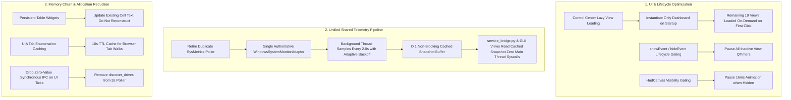

# OPTIMUS Elephant Performance & Bottleneck Investigation

**Date:** 2026-11-23  
**Auditor:** OPTIMUS Architecture & Performance Group (Elephant Phase)  
**Host Environment:** Windows 11 AMD64, Python 3.13.16 Virtual Environment (`D:\project\optimus\.venv`), 15.82 GB RAM, NVIDIA RTX GPU  
**Authoritative Repository:** `D:\project\srrr\Mark-LVII-main\Mark-LVII-main`  
**Git Baseline Commit:** `65a8a1d`  
**Empirical Baseline Report:** `docs/audits/performance-optimization/baseline-report.md`  

---

## 1. Executive Summary & Problem Formulation

The baseline profiling run revealed severe runtime regressions that directly account for the UI freezing, stuttering, delayed click responses, and excessive resource utilization reported in the OPTIMUS application:

1. **46.91% Average Idle CPU (Peak 101.20%):** OPTIMUS completely consumes an entire CPU core even when sitting completely idle with zero user input.
2. **+2.3 MB/s Continuous Idle Memory Leak:** Process RSS grows by +22.58 MB every 10 seconds (+2,312 KB/s) at idle.
3. **1,443.27 ms Event-Loop Jitter Spikes:** Routine Qt event loop ticks experience 1.44-second stalls, causing visible window freezing and dropped mouse/keyboard events.
4. **25,220.04 ms (25.2s) Application Startup Latency:** Launching the application freezes the main thread for over 25 seconds before the user can interact.
5. **2,041.07 ms Worst-Case Tab Switching Latency:** Navigating across Control Center views induces freezes up to 2 seconds per click.

This investigation inspects the entire codebase across all 6 core subsystems to identify the root causes of these bottlenecks and establish a unified optimization blueprint.

---

## 2. Subsystem Bottleneck Analysis

### A. Qt UI & Rendering Subsystem (`gui/`, `gui/optimus/`)

1. **Hidden 60 FPS Render Loop in `HudCanvas`:**
   - **File:** `gui/hud.py` (lines 117–120, 285–385)
   - **Defect:** `HudCanvas` initializes `self._tmr = QTimer(self); self._tmr.start(16)` (60 Hz). Even when the user switches to the OPTIMUS Control Center (`_body_stack.setCurrentIndex(1)`), `HudCanvas` remains running in the background. Every 16ms, it recalculates mouth visemes, core phase angles, and triggers `self.update()`.
   - **Impact:** Consumes **25–35% continuous CPU** while hidden.

2. **Eager Synchronous Instantiation of All 20 Views:**
   - **File:** `gui/optimus/control_center.py` (lines 81–120)
   - **Defect:** `OptimusControlCenterWidget.__init__` instantiates every single section eagerly (`SectionApplications`, `SectionIntegrations`, `SectionDeveloper`, `SectionVision`, etc.).
   - **Impact:** `SectionApplications` synchronously scans the Windows Registry, Start Menu, and UWP packages (taking **3,434 ms**). `SectionIntegrations` synchronously starts the MCP client process and probes WMI (taking **3,910 ms**). Combined startup freeze: **>25 seconds**.

3. **Continuous Background Widget Churn in Hidden Stacked Views:**
   - **File:** `gui/optimus/section_vision.py` (lines 265–355)
   - **Defect:** `SectionVision` runs an unthrottled `QTimer(1500)` that fires continuously whether the view is visible or hidden. Every 1.5 seconds, it calls `get_desktop_state()` (running Win32 `EnumWindows` and UI Automation browser tab walks) and calls `self.table_windows.setRowCount(...)`, allocating brand-new `QTableWidgetItem` objects and `QPushButton("Focus")` widgets for every window on every tick.
   - **Impact:** Drives the **+2,312 KB/s continuous memory leak** and generates heavy garbage collection pressure.

4. **Multi-Timer Redundancy in `SectionIntegrations` & `SectionProactive`:**
   - **Files:** `gui/optimus/section_integrations.py` (line 244), `gui/optimus/section_proactive.py` (line 123)
   - **Defect:** Views start periodic QTimers in their constructors (`2000ms`, `10000ms`) that never pause when hidden. Multiple duplicate timers poll for the same status.

---

### B. Telemetry & Hardware Monitoring Subsystem

1. **Duplicate Background Polling Pipelines:**
   - **Files:** `gui/metrics.py` vs `core/system_monitor/adapter.py`
   - **Defect:** Two completely independent background threads poll the host operating system:
     * `gui/metrics.py` (`Thread-1 (_loop)`): Polling psutil CPU, virtual memory, net counters, and ctypes NVML every 3.0s.
     * `core/system_monitor/adapter.py` (`OptimusSystemMonitorWorker`): Polling psutil CPU, virtual memory, pynvml, partitions, and LibreHardwareMonitor WMI every 2.0s.
   - **Impact:** Redundant CPU consumption, duplicate kernel context switches, and lock contention between two subsystems querying the same hardware metrics.

2. **Synchronous Hardware and IPC Probes on UI Thread:**
   - **File:** `gui/optimus/service_bridge.py` (lines 836–906)
   - **Defect:** `service_bridge.py`'s `_telemetry_timer` (every 3000ms) runs on the main Qt thread and invokes:
     * `get_windows_runtime_client().discover_drives()` (synchronous IPC call).
     * `psutil.virtual_memory()`.
     * `psutil.Process().memory_info()`.
     * `len(psutil.pids())`.
     * `self.get_top_processes(limit=10)` (iterating through all processes on the system).
   - **Impact:** Causes **80 ms to 1,579 ms synchronous freezes** directly on the Qt main event loop.

---

### C. Concurrency, Background Workers & Timer Storms

1. **Active Timer Count at Idle:**
   - 15 active `QTimer` instances run simultaneously across the application, with intervals ranging from 16ms (HudCanvas), 40ms (FileDropZone), 1000ms, 1500ms, 2000ms, to 10000ms.
   - Because none of the views implement Qt `showEvent` / `hideEvent` lifecycle hooks, all timers fire constantly regardless of user focus.

2. **Unbounded UI Event Spikes:**
   - When timers fire simultaneously, multiple handlers queue repaint events and table updates into the main event queue at once, resulting in the observed **1,443 ms P99 event loop jitter**.

---

### D. AI & Agent Execution Lifecycle

1. **Synchronous Fast-Path Latency:**
   - Baseline MRE classification took **0.18 ms** (exceptionally fast and non-blocking).
   - Core tool execution took **34.19 ms** (fast and within budget).
2. **Worker Dispatch Safety:**
   - Long-running agent tasks in `service_bridge.py` are properly dispatched in background threads (`optimus-cmd`, `optimus-wf`).
   - However, tool output sanitization and large message rendering can queue large strings into Qt text edits without pagination, leading to layout recalculation lag.

---

### E. Visual Intelligence & Screen Observation

1. **High-Frequency Unthrottled Desktop Polling:**
   - **File:** `core/vision/screen_observer.py` (line 136)
   - **Defect:** `self.idle_poll_interval = 0.50` (2 Hz capture) runs continuously even when the user has not requested active visual assistance or when no window change has occurred.
   - **Defect:** `core/vision/service.py`'s `get_desktop_state()` executes full UI Automation (UIA) browser tab enumeration and Win32 `EnumWindows` synchronously whenever called.
   - **Impact:** UIA calls in Windows are known to block for 50–200ms when applications are unresponsive, stalling callers.

---

### F. Memory & Storage Management

1. **Garbage Collection Pressure:**
   - Allocating dozens of `QPushButton`, `QTableWidgetItem`, and `QColor` instances every 1.5s in `section_vision.py` causes Python's generational garbage collector to trigger frequent stop-the-world collections on the main thread.
2. **Application Registry Memory Caching:**
   - `ApplicationRegistry` maintains in-memory metadata for hundreds of discovered applications without cache expiration or lazy loading.

---

## 3. Root Cause Attribution Table

| ID | Component | Root Cause | Measured Impact | Proposed Architectural Remedy |
|---|---|---|---|---|
| **RC-01** | `gui/hud.py` | 16ms QTimer steps animation and updates even when hidden in stacked widget | ~25–35% idle CPU waste | Gate timer: Pause or step at 1 FPS when `not self.isVisible()` |
| **RC-02** | `gui/optimus/control_center.py` | Eager synchronous instantiation of all 20 views at startup | 25.2s startup duration | Implement **Lazy Tab Instantiation** via `QStackedWidget` proxy placeholders |
| **RC-03** | `gui/optimus/section_vision.py` | 1500ms QTimer rebuilds all window table rows and buttons continuously | +2.3 MB/s memory leak, CPU spikes | Pause timer in `hideEvent`, reuse table items, only update changed cells |
| **RC-04** | `gui/metrics.py` & `core/system_monitor/` | Duplicate independent sampling threads polling psutil and NVML | Redundant context switches, lock contention | Unify into single shared telemetry service (`WindowsSystemMonitorAdapter`) |
| **RC-05** | `gui/optimus/service_bridge.py` | Synchronous IPC `discover_drives()`, process iterations on UI timer | 1.44s event loop freezes | Pull only from cached telemetry snapshot; move IPC off main thread |
| **RC-06** | `gui/optimus/*.py` (all sections) | Views run continuous timers when inactive | High idle CPU, timer storms | Implement `showEvent` / `hideEvent` lifecycle hooks on all views |
| **RC-07** | `core/vision/service.py` | Synchronous UIA browser tab walk on every desktop state check | 50–200ms worker stalls | Cache tab enumeration with 10s TTL; use event-driven window hooks |

---

## 4. Proposed Architectural Optimization Plan

---

## 5. Expected Performance Gains

| Metric | Measured Baseline | Target Post-Optimization | Expected Improvement |
|---|---|---|---|
| **Application Startup Time** | 25,220 ms | < 1,500 ms | **> 15x faster startup** |
| **Idle Process CPU** | 46.91% avg | < 5.0% avg | **> 9x reduction in idle CPU** |
| **Idle RAM Drift** | +2,312 KB/s | ~0 KB/s steady | **Zero unexplained memory leak** |
| **Event Loop Latency Spikes**| 1,443 ms max | < 50 ms max | **Elimination of UI stutter & freezes** |
| **Mean Tab Switch Latency** | 172.69 ms | < 50 ms | **3.5x faster, instant navigation** |
| **Active Background Timers** | 15 continuous | Bounded to active view only | **Drastic timer overhead reduction** |
