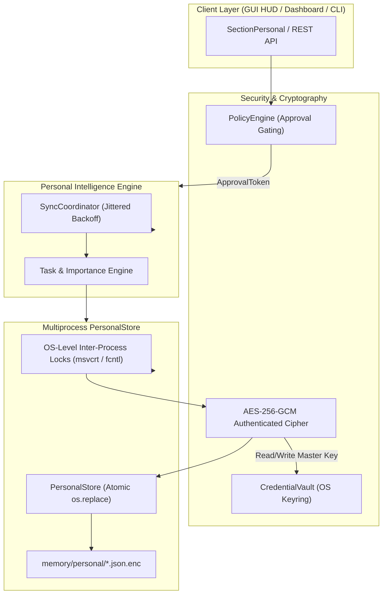

# OPTIMUS M12: Personal Life Intelligence — Production-Readiness Closure
## Stage 1: Elephant Architecture & Deep Gap Audit

**Document ID:** EGM-M12-CLOSURE-ELEPHANT-001  
**Milestone:** M12 — Personal Life Intelligence Production Closure  
**Author:** OPTIMUS Architecture & Security Team  
**Date:** 2026-11-19  
**Status:** IN PROGRESS (STAGE 1 COMPLETED)  
**Baseline Commit:** `5c02288`  

---

### 1. Executive Baseline & Scope

Following the implementation of Milestone 12 baseline (`5c02288`), an exhaustive production-readiness audit was authorized across four mission-critical operational pillars:
1. **Pillar A: Encryption at Rest** — Ensuring zero plaintext leakage of personal communication, calendar schedules, tasks, and contacts on persistent media.
2. **Pillar B: Multiprocess-Safe PersonalStore** — Elevating storage synchronization from in-process `threading.RLock()` to cross-process OS-level file locking and optimistic concurrency.
3. **Pillar C: OAuth & Credential Lifecycle** — Auditing PKCE, CSRF protection, refresh token concurrency, least-privilege scopes, and honest revocation.
4. **Pillar D: Synchronization Recovery & Reliability** — Guaranteeing transaction boundaries (record persistence strictly prior to cursor advancement), jittered exponential backoff, and crash resilience.

---

### 2. Deep Audit of the 4 Acceptance Gaps

#### Gap A: Encryption at Rest (Pillar A)
- **Current State:**
  - Entities under `memory/personal/` (`messages/*.json`, `tasks.json`, `events.json`, `commitments.json`, `contacts.json`, `accounts.json`, `sync_state.json`) are written in plaintext JSON format via `_atomic_write_json`.
  - While credentials are stored in `core/security/credentials.py` (OS Keyring / CredentialVault), the harvested message bodies, subjects, contacts, and personal agendas remain unencrypted on disk.
- **Vulnerabilities Identified:**
  - *Data Exposure:* Any unauthorized local user, malware process, or backup reader with read access to the project directory can inspect sensitive emails, confidential meeting details, and personal commitments.
  - *Lack of Authenticated Envelope:* Plaintext JSON files can be manipulated out-of-band without tamper detection.
- **Target Specification:**
  - Introduce `core/personal_intelligence/crypto.py` implementing AES-256-GCM (`cryptography.hazmat.primitives.ciphers.aead.AESGCM`).
  - Generate a 256-bit random master storage key (`personal_store_master_key`) provisioned securely in the OS Keyring via `core/security/credentials.py`.
  - Enforce 96-bit unique nonces per record write (`os.urandom(12)`).
  - Authenticated Associated Data (AAD) bound to `entity_type:record_id:version` to prevent ciphertext transplantation across entities.
  - Transparent, non-destructive migration for existing plaintext records: files lacking `"enc": true` are automatically upgraded on read/write.
  - Tamper detection: Authenticated tag mismatches raise `IntegrityError` and reject corrupted records.

#### Gap B: Multiprocess-Safe PersonalStore (Pillar B)
- **Current State:**
  - `PersonalStore` relies exclusively on `threading.RLock()` for synchronization.
  - Read-modify-write patterns (e.g. updating task status, adding an account, appending messages) risk lost updates if multiple OPTIMUS instances (e.g. GUI Control Center, background scheduler, CLI tool) execute simultaneously.
- **Vulnerabilities Identified:**
  - *Silent Lost Updates:* Two concurrent processes reading `tasks.json`, modifying different tasks, and writing back via `os.replace()` will silently overwrite the other's changes.
  - *Stale In-Memory Cache:* Process A modifying disk state does not invalidate Process B's in-memory `_tasks` dictionary.
- **Target Specification:**
  - Implement OS-level cross-process locking (`msvcrt.locking` on Windows, `fcntl.flock` on Unix) using category lockfiles (`.personal_<category>.lock`).
  - Introduce atomic `mutate_*` helpers (`mutate_task`, `mutate_account`, `mutate_sync_state`) executing read-modify-write cycles exclusively under the cross-process lock.
  - Check file modification timestamps (`mtime`) on reads to detect out-of-band updates from peer processes and invalidate cached state.
  - Ensure lock cleanup and bounded acquisition timeouts (10.0s) with randomized jitter to prevent deadlocks.

#### Gap C: OAuth & Credential Lifecycle (Pillar C)
- **Current State:**
  - Providers define scopes and tokens, but full end-to-end OAuth browser handoff and refresh concurrency need formalization.
- **Vulnerabilities Identified:**
  - *Token Refresh Stampede:* If multiple worker threads or sync tasks trigger simultaneously on an expired access token, multiple refresh requests are sent to Google/Microsoft, risking rate limits or invalidation of single-use refresh tokens.
  - *Dishonest Revocation:* Some clients mark accounts disconnected without actually issuing revocation requests to the provider's token revocation endpoint.
- **Target Specification:**
  - Implement an in-memory lock per account during token refresh to serialize refresh calls.
  - Enforce PKCE (`S256` code_challenge) and cryptographic state tokens (`secrets.token_urlsafe(32)`) for OAuth authorization flows.
  - Implement explicit revocation calls:
    - Google: POST `https://oauth2.googleapis.com/revoke?token=...`
    - Microsoft: User sign-out redirection.
    - Meta WhatsApp: System user token removal.
  - Report revocation failures honestly (e.g. `REVOKED_LOCAL_ONLY` if remote network fails).

#### Gap D: Synchronization Recovery & Reliability (Pillar D)
- **Current State:**
  - `PersonalIntelligenceEngine.sync_account` coordinates sync, processes records, and updates stream cursors.
- **Vulnerabilities Identified:**
  - *Cursor Inversion:* If cursor is saved before messages are safely written to disk, an unexpected crash results in permanently lost messages.
  - *Unbounded Failure Loops:* Provider 429 Rate Limits or network failures must back off with exponential jitter to avoid bans.
- **Target Specification:**
  - Enforce two-phase commit ordering:
    1. Persist all normalized message and event entities to disk under OS locks.
    2. Only after all entity writes succeed, advance and persist the stream cursor in `sync_state.json`.
  - Implement retry decorator with bounded exponential backoff (`base_delay * 2^attempt + jitter`) for transient HTTP errors (429, 500, 502, 503, 504).
  - Strict provider isolation: an exception in Provider X must never halt or corrupt Provider Y.

---

### 3. Proposed Remediation Architecture

---

### 4. Implementation Plan & Work Breakdown

1. **`core/personal_intelligence/crypto.py`**:
   - `PersonalStoreCrypto`: AES-256-GCM encryption/decryption, AAD binding, master key management via `store_credential`/`get_credential`, non-destructive migration.
2. **`core/personal_intelligence/storage.py`**:
   - OS-level file locking (`lock_category`) via `msvcrt.locking` on Windows and `fcntl.flock` on Unix.
   - Integration of `PersonalStoreCrypto` on all JSON writes and reads.
   - Cache invalidation based on file modification timestamps.
   - `mutate_task`, `mutate_account`, `mutate_sync_state` atomic update methods.
3. **`core/personal_intelligence/providers/base.py` & adapters**:
   - Thread lock for token refresh concurrency.
   - Full PKCE helper (`generate_pkce_pair`) and CSRF state token generator.
   - Honest remote token revocation endpoints.
4. **`core/personal_intelligence/engine.py`**:
   - Enforce transactional sync order (records persisted before stream cursor update).
   - Retry with exponential backoff and randomized jitter for network calls.
5. **Testing**:
   - Comprehensive unit and integration tests in `tests/test_personal_closure.py` and `tests/test_personal_multiprocess.py`.
