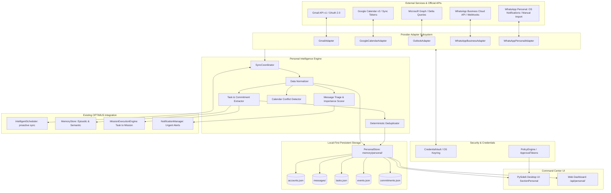
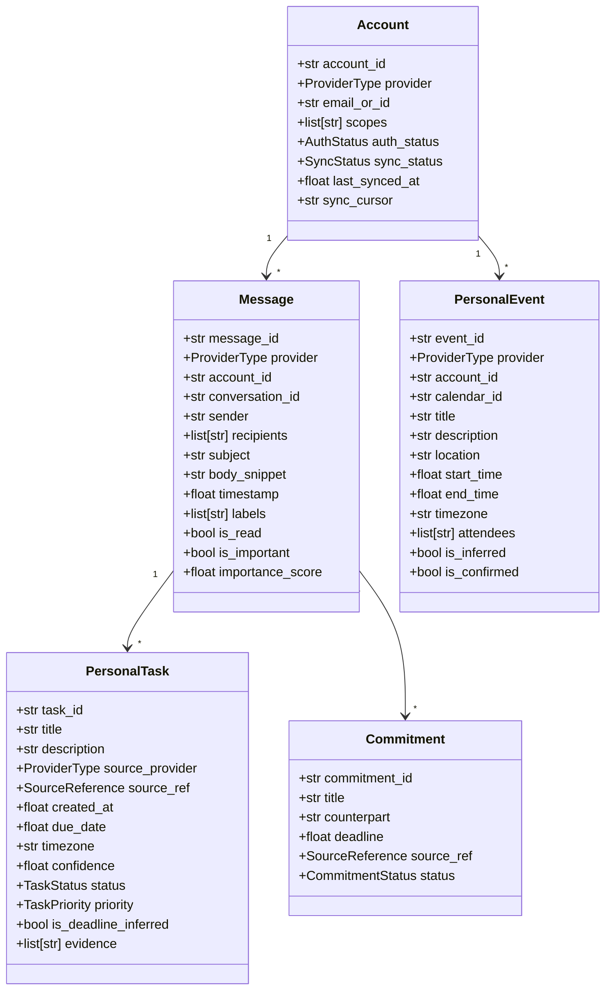

# OPTIMUS — Milestone 12: Personal Life Intelligence
## Elephant Architecture & Investigation Specification

**Document Version:** 1.0.0  
**Milestone:** M12 — Personal Life Intelligence  
**Author:** OPTIMUS Architecture & Systems Engineering  
**Target Repository:** `D:\project\srrr\Mark-LVII-main\Mark-LVII-main`  
**Status:** Design Baseline  

---

## 1. Executive Summary

Milestone 12 establishes the **Personal Life Intelligence** layer in OPTIMUS. This subsystem connects the user's primary communication and scheduling channels (Gmail, Google Calendar, Microsoft Outlook, and WhatsApp) into an integrated, local-first intelligence architecture.

Rather than acting as a disjoint set of email and calendar tools, M12 transforms raw external messages and calendar feeds into unified, actionable internal entities:
- **Actionable Tasks & Commitments** extracted deterministically with explicit evidence links.
- **Unified Timeline & Schedule** consolidating meetings, deadlines, and suggested follow-ups.
- **Unified Inbox & Message Triage** ranking messages by personal importance and extracting obligations.
- **Autonomous Governance** operating under the established 4-tier security framework (`READ`, `PREPARE`, `ROUTINE`, `CRITICAL`), ensuring that sensitive external actions (sending emails, modifying calendars, sharing personal information) require explicit signed Approval Tokens.

The entire architecture is **local-first**: all synchronized communications, extracted tasks, and derived intelligence reside in machine-encrypted local JSON stores (`memory/personal/`), with credentials safely locked in the OS Keyring / machine-bound `CredentialVault`.

---

## 2. System Architecture & Component Responsibilities

### 2.1 Core Subsystem Responsibilities

1. **Provider Adapters (`core/personal_intelligence/providers/`):**
   - Implements `BaseProviderAdapter` interface.
   - Manages OAuth 2.0 PKCE, token refresh, minimum scope negotiation, and rate limits.
   - Executes initial and incremental synchronizations using provider cursors (Gmail History IDs, Google Calendar Sync Tokens, Microsoft Graph Delta Links).
   - Isolates provider failures: an outage or rate-limit on Outlook never impacts Gmail or Calendar.
2. **Personal Intelligence Engine (`core/personal_intelligence/engine.py`):**
   - Coordinates incremental background synchronizations.
   - Normalizes disparate schemas into canonical internal data contracts.
   - Extracts actionable tasks, deadlines, and promises using heuristic parsing validated by deterministic checks.
   - Deduplicates tasks across multiple emails or messages referencing the same commitment.
   - Evaluates schedule conflicts and prepares proactive follow-up suggestions.
3. **Local-First Storage (`core/personal_intelligence/storage.py`):**
   - Atomic disk persistence under `memory/personal/` with exponential backoff for Windows sharing locks.
   - High-performance in-memory indexing by account, provider, status, priority, and date.
   - Strict data minimization: stores metadata and body snippets; sensitive payload encryption at rest.
4. **Governance & Security Integration (`core/security/policy_engine.py`):**
   - Read and prepare actions are permitted under standard user authorization.
   - External modifications (sending emails, modifying events, deleting data) require explicit single-use `ApprovalToken` consumption.
5. **Presentation Layer (`gui/optimus/section_personal.py` & `dashboard/server.py`):**
   - Desktop and web views providing Dashboard, Unified Inbox, My Tasks, Calendar, Connected Accounts, WhatsApp Hub, Automations, and Privacy & Permissions.

---

## 3. Data Contracts & Canonical Entity Model

All provider data is normalized into canonical internal dataclasses defined in `core/personal_intelligence/types.py`:

---

## 4. Provider Adapter Specifications

### 4.1 Gmail Adapter (`GmailAdapter`)
- **API:** Official Google Gmail REST API v1.
- **OAuth Scopes:** `https://www.googleapis.com/auth/gmail.readonly` (default). Optional `gmail.send` required only when outgoing draft/send is explicitly configured.
- **Incremental Synchronization:**
  - Uses `historyId`. On subsequent syncs, calls `users.history.list(startHistoryId=...)`.
  - If `historyId` expires (HTTP 404/410), falls back to controlled full synchronization window (e.g. past 30 days).
- **Metadata Extraction:** Extracts `Message-ID`, `From`, `To`, `Subject`, `Date`, `Thread-ID`, labels (`IMPORTANT`, `UNREAD`).
- **Body Handling:** Extracts plaintext snippet (max 500 characters) for local analysis. Raw full email HTML is discarded to minimize local storage footprint.

### 4.2 Google Calendar Adapter (`GoogleCalendarAdapter`)
- **API:** Official Google Calendar REST API v3.
- **OAuth Scopes:** `https://www.googleapis.com/auth/calendar.readonly` (read-only default), `calendar.events` (for authorized event creation).
- **Incremental Synchronization:**
  - Uses `syncToken`. Calls `events.list(calendarId='primary', syncToken=...)`.
  - When token expires (HTTP 410 Gone), clears cursor and resynchronizes recent window.
- **Conflict Detection:** Identifies overlapping events across primary and secondary calendars.

### 4.3 Microsoft Outlook Adapter (`OutlookAdapter`)
- **API:** Microsoft Graph REST API v1.0.
- **OAuth Scopes:** `Mail.Read`, `Calendars.Read`, `offline_access`.
- **Incremental Synchronization:**
  - Mail: Uses Delta Query `GET /me/mailFolders/inbox/messages/delta`.
  - Calendar: Uses Delta Query `GET /me/calendarView/delta?startDateTime=...&endDateTime=...`.
  - Delta tokens persisted locally; expired tokens fall back to date-window resync.

### 4.4 WhatsApp Business Adapter (`WhatsAppBusinessAdapter`)
- **API:** Official Meta WhatsApp Business Cloud API.
- **Account Eligibility:** Validated Meta Business Account with registered Phone Number ID and System User Access Token.
- **Webhook Ingestion:**
  - `GET /webhook/whatsapp`: Hub challenge verification using configurable `verify_token`.
  - `POST /webhook/whatsapp`: Signature verification using `X-Hub-Signature-256` HMAC-SHA256 with `app_secret`.
  - Idempotent processing: Deduplicates incoming webhook `message.id` via memory cache to prevent duplicate processing of webhook retries.
- **Outbound Communication:** Strictly uses pre-approved Meta message templates or active 24-hour service windows, gated by PolicyEngine approval.

### 4.5 WhatsApp Personal Adapter (`WhatsAppPersonalAdapter`)
- **Honest Architectural Boundary:** There is **no general-purpose public official API** for personal consumer WhatsApp accounts.
- **Permitted Safe Capabilities:**
  1. *Explicit Sharing / Forwarding:* Ingestion of user-shared chat exports or individual message payloads.
  2. *OS Notification Ingestion:* Read-only capture of incoming WhatsApp desktop notifications via Windows Notification Listener (if enabled and granted by operator).
  3. *Handoff Actions:* Preparing pre-filled `https://wa.me/<number>?text=<encoded_text>` links to allow one-click operator sending via official WhatsApp Desktop or Web without unauthorized scraping.
- **Strictly Prohibited:** No reverse-engineered WhatsApp Web sessions, no browser cookie theft, no puppeteer/playwright session injection, no risk of account banning.

---

## 5. Personal Intelligence & Task Extraction Engine

### 5.1 Deterministic Task Extraction Framework
The extraction pipeline executes in three stages:
1. **Candidate Identification:** Scans message text for actionable commitment patterns (e.g., "I will send", "please review", "deadline is", "by Friday", "can you provide", "following up on").
2. **Entity & Date Parsing:**
   - Detects explicit deadlines ("by Nov 25 at 5pm", "before tomorrow 10:00 AM").
   - Normalizes all timestamps to UTC with source timezone offset.
   - Distinguishes **Explicit Deadlines** (specified in text) from **Inferred Deadlines** (e.g. implied urgency).
3. **Deterministic Deduplication (Reconciled with MED-01):**
   - Generates a deduplication key anchored to conversation context:
     $$\text{Key} = \text{SHA256}(\text{normalized\_title} + \text{counterpart\_id} + \text{conversation\_id})$$
   - Only active tasks (`PENDING`, `IN_PROGRESS`, `WAITING`) are checked for deduplication; `COMPLETED` and `CANCELLED` tasks are strictly exempt to allow recurring obligations.
   - If an existing active task matches, updates the evidence ledger and source references without spawning duplicate task records.

### 5.2 Message Triage & Importance Scoring
Computes an `importance_score` ($0.0 \to 1.0$) based on:
- VIP / Frequent contact status (+0.3)
- Urgent action keywords (+0.2)
- Direct 1-on-1 recipient vs broadcast mailing list (+0.2)
- Thread activity / follow-up recency (+0.1)
- Provider "Important" flags (+0.2)

Messages with score $\ge 0.75$ trigger priority notification evaluation.

---

## 6. Security, Privacy, and Governance

1. **Credential Isolation:** Provider OAuth tokens and API secrets stored in OS Keyring / machine-bound AES-128 Fernet `CredentialVault`. Never stored in source, logs, or frontend storage.
2. **Encryption at Rest:** Message snippets and contact details stored with local encryption key derived from machine seed.
3. **Four-Tier Action Governance:**
   - `READ`: Automated background sync permitted when scopes authorized.
   - `PREPARE`: Drafting emails, generating task suggestions, creating reminders permitted without operator interruption.
   - `ROUTINE`: Internal state updates and non-destructive triage permitted.
   - `CRITICAL`: Consequential external mutations (send email, delete message, update external calendar, send WhatsApp message) **strictly require single-use ApprovalToken**.
4. **Data Minimization & Deletion:**
   - Configurable retention periods (default 30 days for cached message snippets).
   - "Forget Provider" action instantly purges all local cached messages, events, and tasks associated with that provider.
   - "Wipe All Personal Data" completely deletes `memory/personal/` directory.

---

## 7. Synchronization & Reliability Architecture

- **Independent Worker Isolation:** Synchronizations execute in dedicated worker threads via `SyncCoordinator`.
- **Multi-Tenant Stream Cursor Persistence (Reconciled with HIGH-03 & LOW-02):** `memory/personal/sync_state.json` tracks cursors partitioned by `account_id` and stream (`mail`, `calendar:primary`). High-frequency cursor churn is isolated from `accounts.json`.
- **Bounded Backoff:** Exponential retry on transient HTTP 429/503 errors ($delay = 2^{\text{attempt}} + \text{jitter}$).
- **Proactive Scheduler Binding:** Integrates directly with OPTIMUS `IntelligentScheduler` to run periodic background syncs (default every 15 minutes) without blocking UI threads.
- **WhatsApp Webhook Ingress (Reconciled with HIGH-02):** Outbound sending via Meta REST API functions directly. Inbound webhooks in desktop environments require an operator-configured HTTPS tunnel (Cloudflare Named Tunnel or ngrok endpoint configured in `CredentialVault`). In the absence of a tunnel, outbound functionality remains 100% operational while inbound logging guides setup.

---

## 8. Acceptance Criteria

1. Provider adapter contracts pass 100% of unit and mocked synchronization tests.
2. WhatsApp Personal boundaries are clearly separated from Business API capabilities.
3. Task extraction reliably identifies actionable commitments and prevents duplicate records.
4. Consequential external operations are blocked unless authorized with an `ApprovalToken`.
5. Local data deletion completely purges all cached personal entities.
6. The UI correctly renders all 8 Personal Intelligence views in the cinematic JARVIS aesthetic.
7. Full test suite executes cleanly with zero failures and passes Ruff linting.
