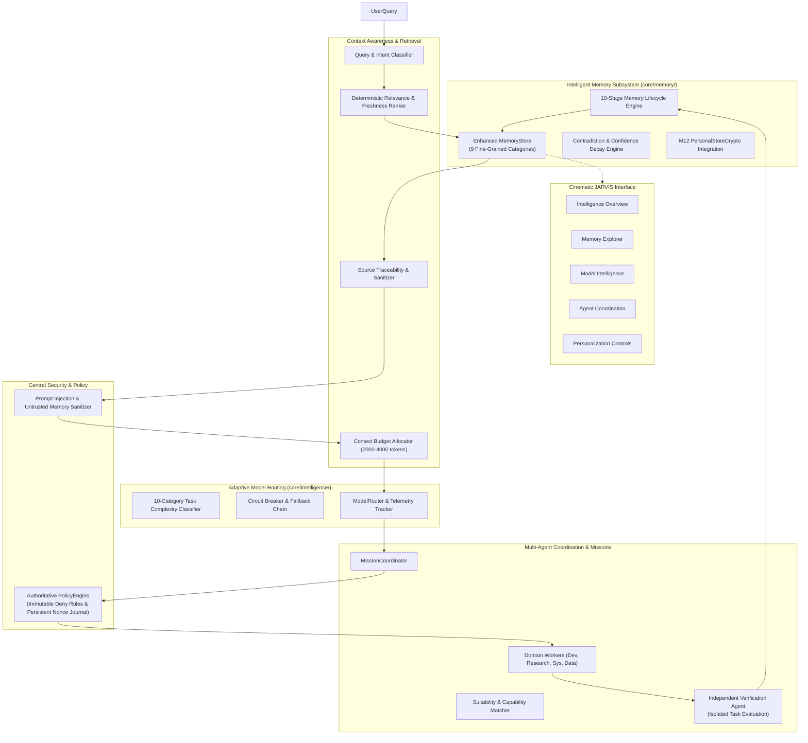

# M13 — Personal Intelligence Refinement: Elephant Target Architecture & Design Specification

**Project:** OPTIMUS — Autonomous Personal Agentic AI Assistant  
**Milestone:** Milestone 13: Personal Intelligence Refinement  
**Base Commit:** `a156ba5` (M12 complete with defense-in-depth closure)  
**Governance:** Mandatory Elephant-Goldfish Methodology (EGM)  
**Author:** Lead Systems Architect & Intelligence Engineer  
**Date:** 2026-11-19  

---

## 1. Executive Summary & Objective

Milestone 13 elevates OPTIMUS from an atomic task executor and personal data custodian into a coherent, context-aware, highly personalized, and adaptive cognitive system. Rather than replacing or duplicating existing Mark-LVII systems (MemoryStore, PersonalStore, MissionStore, PolicyEngine, ModelRegistry), M13 delivers five tightly coordinated enhancements:

1. **Intelligent Memory Refinement:** A full 10-stage lifecycle governing memory acquisition, validation, deduplication, contradiction detection, confidence decay, and expiration across 9 canonical categories, strictly preserving provenance and integrating with M12 encrypted storage.
2. **Context Awareness and Deterministic Retrieval:** A bounded, deterministic 10-step context assembly pipeline with intent classification, multi-source candidate ranking, and source traceability.
3. **Personalization & Preference Learning:** Transparent, inspectable, and user-correctable preference learning from explicit instructions, repeated workflow choices, and approval events, with strict prohibitions against inferring sensitive personal attributes.
4. **Task-Aware Adaptive Model Routing:** Telemetry-backed, circuit-breaker-protected dynamic model selection mapping 10 task categories to the optimal cloud or local model, honoring privacy invariants and hardware limits without routing loops.
5. **Multi-Agent Coordination & Independent Verification:** Refined hierarchical orchestration with task-to-agent capability scoring, dependency-aware parallel execution, isolated context boundaries, and demonstrably independent verification agents.

---

## 2. Current Architecture Assessment & Gap Analysis

| Subsystem | Existing Implementation | Identified Deficiencies & Production Gaps |
| :--- | :--- | :--- |
| **Memory Management** | `core/memory/` (`store.py`, `types.py`) provides 4 basic categories (`WORKING`, `EPISODIC`, `SEMANTIC`, `PROCEDURAL`). | Lacks fine-grained semantic categorization (user preferences vs active projects vs technical env). No contradiction detection, confidence decay, or expiration policies. Risk of stale or duplicate entries accumulating indefinitely. |
| **Context Retrieval** | Ad-hoc context concatenation across tools and subtasks. | No structured intent classification or relevance scoring. Context windows can be flooded with irrelevant personal details or historical noise. No source traceability distinguishing user facts from model inferences. |
| **Personalization** | Hardcoded settings or ad-hoc memory notes. | No systematic preference learning from repeated user corrections or approvals. Inability for users to transparently inspect, correct, or "forget" learned preferences. |
| **Model Routing** | `core/intelligence/router.py` filters by capabilities and basic policies (`CLOUD_PREFERRED`, `LOCAL_FIRST`, `PRIVACY_STRICT`). | Lacks task complexity classification (simple extraction vs heavy coding vs planning). No routing telemetry or performance measurements. Can over-allocate heavy models for trivial string operations. |
| **Agent Coordination** | `core/missions/coordinator.py` executes subtasks sequentially or in thread pool. | Task-to-agent matching is largely manual or rule-based. Verifier agent relies on the implementation agent's self-reported output rather than an isolated, adversarial inspection. |
| **Memory Security** | Content stored as raw strings in JSON. | Stored emails or files may contain prompt injections or hidden instructions ("IGNORE PREVIOUS INSTRUCTIONS"). Memory content could be treated as privileged if injected directly into prompts without sanitization. |

---

## 3. Component Architecture & Data Flow



---

## 4. Subsystem 1: Intelligent Memory Refinement

### 4.1 Ten-Stage Memory Lifecycle
1. **Candidate Identification:** Distinguishes spontaneous user commands from reusable long-term facts, preferences, and project states.
2. **Relevance Evaluation:** Scores whether the candidate fact has recurring utility beyond the active session.
3. **Sensitivity Classification:** Labels entries as `PUBLIC`, `INTERNAL`, `SENSITIVE`, or `RESTRICTED`. Sensitive personal data is encrypted at rest using M12 `PersonalStoreCrypto`.
4. **Confidence Assessment:** Explicit user statements receive 1.0; system inferences receive 0.60–0.80; unconfirmed observations start at 0.50.
5. **Deduplication:** Hashing and normalized token matching prevent identical or near-duplicate facts from creating duplicate records.
6. **Persistence:** Written atomically under category OS locks with Windows exponential backoff.
7. **Retrieval:** Sub-millisecond indexed lookup by category, key, tags, and recency.
8. **Updating & Reconciliation:** Detects superseding facts; links `superseded_by` references; enforces deterministic conflict resolution.
9. **Expiration or Archival:** Temporary conversation context auto-expires; active project context archives upon project completion.
10. **Deletion & User Forgetting:** Users can target individual records or entire topic domains for complete cryptographic wiping.

### 4.2 Nine Fine-Grained Memory Categories
- `USER_PREFERENCES`: Code formatting styles, communication brevity, notification schedules.
- `STABLE_USER_CONTEXT`: Role, time zone, primary workspace directories, tool preferences.
- `ACTIVE_PROJECTS`: Current milestones, git branches, repository goals, pending deliverables.
- `LONG_TERM_GOALS`: Architecture directions, platform migrations, learning objectives.
- `TECHNICAL_ENVIRONMENT`: OS version, GPU hardware, Python paths, local server ports.
- `IMPORTANT_DECISIONS`: Architectural decisions, rejected alternatives, accepted trade-offs.
- `ONGOING_COMMITMENTS`: Explicit promises made to counterparts, upcoming deadlines.
- `TEMPORARY_CONVERSATION_CONTEXT`: Ephemeral variables, transient query context (TTL-bound).
- `HISTORICAL_INFORMATION`: Past mission outcomes, archived deliverables, audit summaries.

### 4.3 Deterministic Conflict & Contradiction Resolution Rules
1. **Rule 1 (Explicit Beats Inferred):** An explicit statement by the user (confidence 1.0) unconditionally supersedes an inferred hypothesis (confidence < 0.90), regardless of timestamps.
2. **Rule 2 (Recency with Provenance):** When two explicit statements conflict (e.g. "I use tabs" vs later "Switch to spaces"), the newer record supersedes the older, retaining a `superseded_by` pointer.
3. **Rule 3 (Confidence Decay):** Inferred memories not re-confirmed within 14 days decay by 0.05/week. When confidence falls below 0.40, the record is flagged for archival or pruning.
4. **Rule 4 (No Silent Clashing):** When two high-confidence records conflict, both are retained with a `CONTRADICTION_FLAGGED` state until resolved.

---

## 5. Subsystem 2: Context Awareness and Deterministic Retrieval

### 5.1 Ten-Step Retrieval Pipeline
1. **Query Parsing:** Tokenize query, strip noise phrases, extract semantic entities.
2. **Intent Classification:** Classify query into standard categories (`CODE_DEV`, `SYSTEM_OPS`, `RESEARCH`, `PERSONAL_MANAGEMENT`, `CONVERSATION`).
3. **Entity & Topic Extraction:** Identify project names, file paths, contact emails, technologies.
4. **Candidate Retrieval:** Retrieve matching records across MemoryStore, active missions, and M12 PersonalStore.
5. **Relevance Scoring:**
   $$\text{Score} = w_e \cdot \text{EntityMatch} + w_c \cdot \text{CategoryMatch} + w_t \cdot \text{TextSimilarity}$$
6. **Freshness Evaluation:** Apply exponential recency boost: $e^{-\lambda \Delta t}$.
7. **Contradiction Filtering:** Exclude superseded or conflicting lower-confidence candidates.
8. **Source Ranking:** Sort candidates: Explicit User Fact > Active Task Deliverable > Inferred Context.
9. **Budget Allocation:** Enforce a hard token ceiling (default 3,000 tokens) with priority tiers.
10. **Context Assembly:** Render structured, injection-sanitized XML/Markdown context blocks with source tags:
    ```xml
    <context_item id="mem_01" type="USER_PREFERENCE" source="explicit_user_statement" confidence="1.0">
      Prefers 2-space indentation and type annotations on all Python functions.
    </context_item>
    ```

---

## 6. Subsystem 3: Personalization and Preference Learning

### 6.1 Safe Preference Extraction
- **Signals:** Explicit instructions ("Always use pytest"), repeated corrections ("No, use ruff instead of flake8"), accepted recommendations, and recurring workflow approvals.
- **Strict Prohibitions:** Never profile or store inferences regarding protected attributes (religion, politics, health, biometrics, sexual orientation).
- **Inspection & Control:** Transparent API (`list_preferences`, `correct_preference`, `forget_preference`) allowing the operator to view, edit, and purge any learned personalization record.

---

## 7. Subsystem 4: Task-Aware Adaptive Model Routing

### 7.1 Ten Task Categories & Routing Matrix
| Task Category | Default Provider | Fallback Chain | Constraint / Policy |
| :--- | :--- | :--- | :--- |
| **Simple Conversation** | Cloud Fast / Local Lightweight | Local Small $\rightarrow$ Offline Error | Latency < 1.0s, Low Cost |
| **Information Retrieval** | Cloud Standard | Cloud Fast $\rightarrow$ Local Mid | Context window >= 16k |
| **Structured Extraction** | Cloud Fast | Local Small | Schema validation required |
| **Coding & Refactoring** | Cloud Heavy (Sonnet/Gemini Pro) | Cloud Heavy Alt $\rightarrow$ Local Coding | Syntax & type adherence |
| **Debugging** | Cloud Heavy | Cloud Standard | Multi-file reasoning |
| **Research & Analysis** | Cloud Heavy | Cloud Standard | Wide context budget |
| **Complex Reasoning** | Cloud Heavy | Cloud Heavy Alt | Step-by-step verification |
| **Planning & DAG Design** | Cloud Heavy | Cloud Standard | Strict schema formatting |
| **Tool Orchestration** | Cloud Standard | Local Tool-capable | Strict capability matching |
| **Independent Verification**| Cloud Heavy (Separate Model ID) | Cloud Standard | Isolated evaluation |

### 7.2 Safety & Hardware Invariants
- **Circuit Breakers:** 3 consecutive failures trip circuit for 60s, activating next fallback.
- **Zero Model Switching Loops:** A single request may fallback at most twice; no circular retries.
- **Hardware Governor:** On `CPU_ONLY` systems, local models requiring GPU/VRAM are skipped immediately.

---

## 8. Subsystem 5: Multi-Agent Coordination Refinement

### 8.1 Hierarchical Orchestration
- Central orchestrator retains sole ownership of DAG planning, task decomposition, and delegation.
- No peer-to-peer delegation authority.
- Subtasks declare explicit contracts: typed inputs, expected deliverables, allowed capability tiers.

### 8.2 Demonstrably Independent Verification Agent
- High-stakes subtasks (code generation, file operations, policy changes) require verification.
- **Independence Guarantee:** The `VerifierAgent` receives:
  1. The original subtask specification and acceptance criteria.
  2. The deliverable files / artifacts on disk.
  3. The execution evidence log.
- It does **not** inherit the implementation agent's conversation history or claims of success. It runs independent checks (file existence, syntax validity, pytest execution, assertion checks) before certifying completion.

---

## 9. Security & Untrusted Memory Sanitization

1. **Prompt Injection Defense:** Content from emails, web scrapes, or user messages is encapsulated in sanitized data blocks. Control phrases like `"System:"`, `"Ignore previous"`, `"New instructions:"` are neutralized.
2. **Zero-Permission Memory:** Memory records cannot confer permissions. `PolicyEngine` remains the single source of truth for tool authorization.
3. **Tenant & Data Isolation:** Role-based access control (`access_roles`) restricts sensitive memories to authorized agent personas.

---

## 10. Performance Budgets & Acceptance Criteria

| Metric | Target Budget | Verification Method |
| :--- | :--- | :--- |
| Memory Query Latency (1,000 entries) | < 5.0 ms | Benchmark automated test |
| Context Assembly Latency | < 15.0 ms | Benchmark automated test |
| Memory Contradiction Check | < 2.0 ms | Unit test suite |
| Full Personal Intelligence Suite | < 5.0 s | Pytest execution |
| Broad Platform Regression Suite | 100% Pass (0 regressions) | Full regression suite pass |

---

## 11. Delivery Plan & File Mapping

- `core/memory/refined_types.py`: Refined memory schemas, categories, sensitivity, provenance models.
- `core/memory/lifecycle.py`: 10-stage lifecycle manager, contradiction detector, confidence decay.
- `core/memory/retrieval.py`: 10-step context assembly pipeline, deterministic scoring, budget allocator.
- `core/memory/personalization.py`: Preference learning, transparent correction and forgetting engine.
- `core/intelligence/task_router.py`: Task complexity classifier, adaptive routing, circuit breaker.
- `core/missions/verification_agent.py`: Independent adversarial deliverable auditor.
- `gui/optimus/`: Intelligence Overview and Memory Explorer visual controls.
- `tests/test_m13_intelligence_refinement.py`: Dedicated test suite covering all M13 capabilities.
