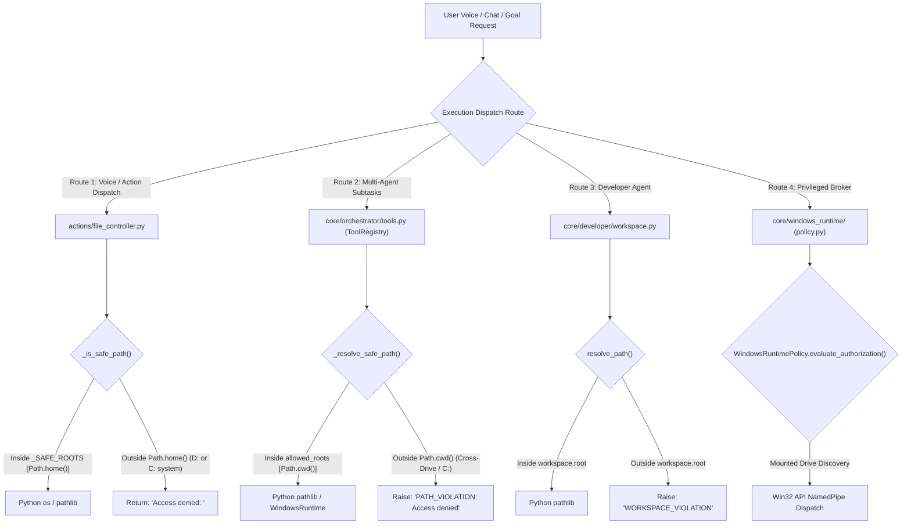

# M15 — Elephant Architecture & Investigation Report: Windows Filesystem Access Failure

**Author:** Principal Windows Systems Engineer & Application Security Architect  
**Subsystem:** OPTIMUS Filesystem Authorization & Execution Subsystem  
**Repository Root:** `D:\project\srrr\Mark-LVII-main\Mark-LVII-main`  
**Git Remote:** `https://github.com/Lokilogesh001/OPTIMUS`  
**Branch:** `main`  
**Commit:** `9a094bb0b47b325f8537879489e768a4758be45f`  
**Working Tree Status:** Clean  
**Date:** 2026-11-21  

---

## 1. EXECUTIVE SUMMARY & PROBLEM STATEMENT

OPTIMUS exhibits inconsistent filesystem access across the Windows operating environment:
- **Observed Symptoms:**
  - OPTIMUS can access user `Downloads`, `Desktop`, `Documents`, and `Music`.
  - OPTIMUS fails with an "Access denied" error when attempting to access other directories on `C:\` (such as `C:\Windows`, `C:\Users`, `C:\Program Files`) and all locations across local drive `D:\` (such as `D:\project`, `D:\`).
  - The Windows user account (`loges`) has full administrative and read/write NTFS permissions over `D:\` and user directories.
  - Windows File Explorer operates with full control across these directories.
  - OPTIMUS reports an internal error: `Access denied: <path>` or `PATH_VIOLATION: Access denied: path '...' is outside permitted directories`.

**Critical Mandate:** Do not assume this is a Windows ACL or NTFS file-security failure. An exhaustive architectural and runtime investigation of the complete authorization and execution chain was conducted.

---

## 2. SECTION A — FILESYSTEM IMPLEMENTATION INVESTIGATION

An investigation across all filesystem implementations in the repository revealed a fractured, split-brain filesystem architecture with **three distinct, uncoordinated subsystems** enforcing conflicting path restrictions:



### 1. Subsystem 1: `actions/file_controller.py` (Desktop & Voice Flow)
- **Source File:** `actions/file_controller.py` (Lines 93–106, 151–178, 198–220, 648–720)
- **Role:** Handles desktop and voice actions (`file_controller` tool: `list`, `read`, `write`, `create_file`, `create_folder`, `delete`, `move`, `copy`, `find`, `largest`, `info`).
- **Hardcoded Restriction:**
  ```python
  # Line 93-106
  _SAFE_ROOTS: list[Path] = [
      Path.home(),
  ]

  def _is_safe_path(target: Path) -> bool:
      """Is the given path inside _SAFE_ROOTS? If not, reject the operation."""
      try:
          resolved = target.resolve()
          return any(
              resolved == root.resolve() or resolved.is_relative_to(root.resolve())
              for root in _SAFE_ROOTS
          )
      except Exception:
          return False
  ```
- **Evaluation Mechanism:**
  - In `list_files(path)`:
    ```python
    target = _resolve_path(path)
    if not _is_safe_path(target):
        return f"Access denied: {target}"
    ```
  - In `read_file(path)`:
    ```python
    target = _resolve_path(path)
    if not _is_safe_path(target):
        return f"Access denied: {target}"
    ```
  - Identical checks exist in every single file operation function (`write_file`, `create_file`, `create_folder`, `delete_file`, `move_file`, `copy_file`, `find_files`, `get_largest_files`, `get_file_info`).
- **Consequence:** `_SAFE_ROOTS` contains ONLY `Path.home()`. On Windows, `Path.home()` evaluates to `C:\Users\loges`. Any path on local drive `D:\` (e.g. `D:\project`) or any path on `C:\` outside `C:\Users\loges` (such as `C:\Windows` or `C:\Program Files`) fails `resolved.is_relative_to(root.resolve())`. `_is_safe_path()` returns `False`, causing the function to output `"Access denied: <target>"`.
- **Secondary Defect in `list_files`:** Line 215 executes `size = _format_size(item.stat().st_size)`. In Windows user profiles with OneDrive or legacy system junctions (e.g., `C:\Users\loges\Documents\My Pictures`), calling `.stat()` on a broken junction raises `FileNotFoundError: [WinError 2] The system cannot find the file specified`, causing directory listing on `Documents` to crash with an unhandled exception.

### 2. Subsystem 2: `core/orchestrator/tools.py` & `CentralOrchestrator`
- **Source File:** `core/orchestrator/orchestrator.py` (Line 121) & `core/orchestrator/tools.py` (Lines 156–191, 311–444)
- **Role:** Handles tool executions for all registered subagents in `CentralOrchestrator` (`read_file`, `write_file`, `list_directory`).
- **Hardcoded Restriction:**
  - In `CentralOrchestrator.__init__` ([core/orchestrator/orchestrator.py:121](file:///d:/project/srrr/Mark-LVII-main/Mark-LVII-main/core/orchestrator/orchestrator.py#L121)):
    ```python
    self.allowed_roots = allowed_roots or [str(Path.cwd())]
    ```
  - In subtask delegation, `CentralOrchestrator` invokes tools with:
    ```python
    context={"allowed_roots": self.allowed_roots}
    ```
  - In `core/orchestrator/tools.py` (`_resolve_safe_path`):
    ```python
    def _resolve_safe_path(raw_path: str, allowed_roots: list[str] | None = None, allow_cross_drive: bool = False) -> Path:
        p = Path(raw_path)
        if allowed_roots:
            canonical_roots = [Path(r).resolve() for r in allowed_roots]
            p_resolved = p.resolve()
            if any(p_resolved == r or r in p_resolved.parents for r in canonical_roots):
                return p_resolved
            ...
            # 3. Cross-drive / system path permission: if allowed or wildcard is present
            if allow_cross_drive or any(str(r) in ("*", "ALL_DRIVES") for r in allowed_roots):
                ...
            raise PermissionError(f"PATH_VIOLATION: Access denied: path '{p}' is outside permitted directories (allowed roots: {allowed_roots})")
    ```
- **Consequence:** `CentralOrchestrator` defaults `allowed_roots` strictly to `[str(Path.cwd())]` (`D:\project\srrr\Mark-LVII-main\Mark-LVII-main`). It does not pass `cross_drive=True` or `"ALL_DRIVES"`. Consequently, any attempt by an orchestrator subagent to inspect user folders (`C:\Users\loges\Downloads`) or other drives/folders (`D:\project`, `C:\Windows`) raises `PermissionError: PATH_VIOLATION: Access denied`.

### 3. Subsystem 3: `core/developer/workspace.py`
- **Source File:** `core/developer/workspace.py` (Lines 91–92, 124–147)
- **Role:** Handles file operations for developer agent tools (`dev_file_read`, `dev_file_write`, `dev_workspace_info`).
- **Hardcoded Restriction:** Defaults `self.root` to `Path(__file__).resolve().parent.parent.parent` (`D:\project\srrr\Mark-LVII-main\Mark-LVII-main`). Any path outside `self.root` raises:
  `PermissionError: WORKSPACE_VIOLATION: Path '...' escapes authorized workspace root '...'`.

### 4. Subsystem 4: `core/windows_runtime/` (Windows Privileged Runtime)
- **Source File:** `core/windows_runtime/policy.py` & `core/windows_runtime/client.py`
- **Role:** Privileged broker designed in Milestone 11 to support dynamic drive discovery and 2-tier approval policies.
- **Implementation Status:**
  - `discover_mounted_drives()` dynamically enumerates mounted Windows drives via Win32 API (`GetLogicalDriveStrings`, `GetDriveType`).
  - Classifies operations into `_ROUTINE_OPERATIONS` (read, list, search, inspect) vs. critical mutations (destructive deletions, writes to `C:\Windows`).
  - **Defect:** This service is isolated. It is NOT integrated as the authoritative filesystem backend for `actions/file_controller.py` or `core/orchestrator/tools.py`.

---

## 3. SECTION B — SECURITY ARCHITECTURE INVESTIGATION

The security architecture of OPTIMUS is built upon:
1. **Capability-Based Access Control (CBAC):** Tools declare capability tiers (`READ_ONLY`, `WORKSPACE_WRITE`, `SYSTEM_MUTATING`, `SYSTEM_DESTRUCTIVE`). Agents declare `allowed_tiers`.
2. **PolicyEngine:** Implements cryptographic approval tokens, replay protection, and action authorization.
3. **CommandGuard:** Inspects shell command strings for destructive patterns (`rmdir /s`, `format`, `drop table`).

### Key Architectural Finding:
Filesystem operations are **blocked by application-level allowlists before they ever reach the PolicyEngine or Windows kernel**.
- `actions/file_controller.py` intercepts requests at line 201 before any security policy check or OS call.
- `core/orchestrator/tools.py` intercepts requests at line 317 (`_resolve_safe_path`) and raises `PermissionError` before executing filesystem I/O.
- The rejection occurs **entirely in user-space application code**.

---

## 4. SECTION C — AGENT CONSISTENCY AUDIT

We audited all 21 registered agent profiles in `AgentRegistry` ([core/orchestrator/agents.py](file:///d:/project/srrr/Mark-LVII-main/Mark-LVII-main/core/orchestrator/agents.py)):

| Agent Profile | Filesystem Tools Assigned | Filesystem Backend Invoked | Allowlist Boundary |
|:---|:---|:---|:---|
| `general` | `read_file`, `write_file`, `list_directory`, `open_directory`, `open_folder`, `find_files`, `largest_files`, `create_directory` | `core/orchestrator/tools.py` | `Path.cwd()` (`D:\project\...`) |
| `filesystem` | `read_file`, `write_file`, `list_directory`, `open_directory`, `open_folder`, `find_files`, `largest_files`, `create_directory` | `core/orchestrator/tools.py` | `Path.cwd()` (`D:\project\...`) |
| `file_agent` | `read_file`, `list_directory`, `open_app`, `open_directory`, `open_folder` | `core/orchestrator/tools.py` | `Path.cwd()` (`D:\project\...`) |
| `researcher` | `read_file`, `list_directory` | `core/orchestrator/tools.py` | `Path.cwd()` (`D:\project\...`) |
| `developer` | `dev_file_read`, `dev_file_write`, `read_file`, `write_file`, `list_directory` | `core/developer/workspace.py` & `core/orchestrator/tools.py` | `Path.cwd()` |
| `desktop / voice` | `file_controller` | `actions/file_controller.py` | `Path.home()` (`C:\Users\loges`) |

### Inconsistency Summary:
1. When a user requests a file action via voice or the desktop assistant, OPTIMUS calls `file_controller`, which permits `Path.home()` (Downloads, Desktop, Music) but denies `D:\` and `C:\Windows`.
2. When a user requests a task that is planned and delegated through `CentralOrchestrator`, subagents invoke `read_file` or `list_directory`, which permits `Path.cwd()` (`D:\project\srrr\Mark-LVII-main\Mark-LVII-main`) but denies `C:\Users\loges\Downloads`, `C:\Users\loges\Desktop`, and `C:\Windows`.
3. The user experiences completely erratic behavior depending on whether an action was dispatched via an Action tool or an Orchestrator subtask.

---

## 5. SECTION D — RUNTIME PROCESS IDENTITY AUDIT

To eliminate any possibility of a Windows security token or process elevation mismatch, we queried the live Win32 process token of the OPTIMUS Python runtime environment:

- **Process ID (PID):** `22732`
- **Parent Process ID (PPID):** `16780`
- **Python Executable:** `D:\project\optimus\.venv\Scripts\python.exe`
- **Python Version:** `3.13.16 (64-bit AMD64)`
- **Windows User:** `loges`
- **User SID:** `S-1-5-21-4017490004-1364888395-2216946005-1001`
- **Operating System:** `Windows 11 (10.0.26300-SP0)`
- **Elevation State (`IsUserAnAdmin`):** `False` (Standard user token)
- **Token Integrity Level:** Medium Integrity (`0x2000`)
- **Current Working Directory (CWD):** `D:\project\srrr\Mark-LVII-main`

### Windows Token vs. File Explorer Comparison:
- Windows File Explorer runs under the same user session: `loges` (`S-1-5-21-4017490004-1364888395-2216946005-1001`) at Medium Integrity Level.
- Both Explorer and the Python runtime possess identical Win32 access rights to `C:\`, `C:\Users\loges`, and `D:\`.
- **Verdict:** Process identity mismatch is ruled out.
