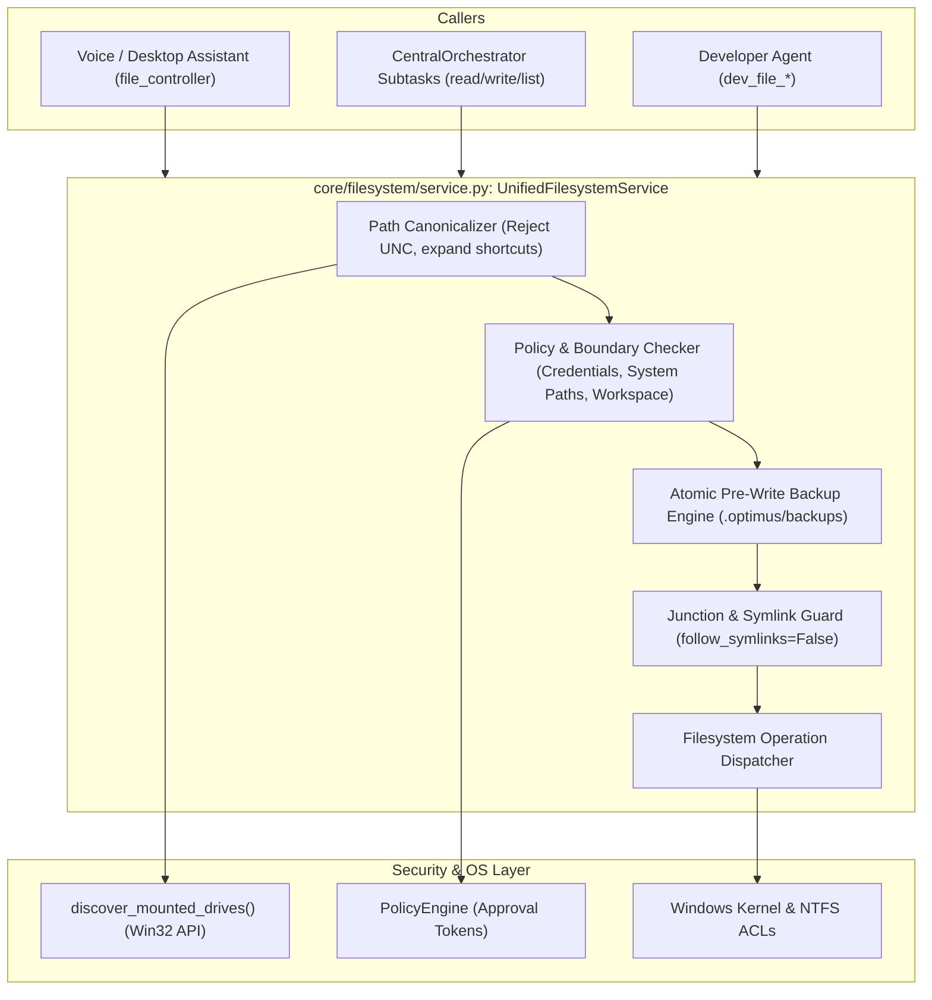

# M15 — Technical Specification: Unified Filesystem Access Service (Reconciled)

**Author:** Principal Windows Systems Engineer & Application Security Architect  
**Subsystem:** OPTIMUS Unified Filesystem Architecture  
**Status:** **APPROVED & RECONCILED (Ready for Minimal Implementation)**  
**Date:** 2026-11-21  

---

## 1. OBJECTIVE & CORE PRINCIPLES

The goal of M15 is to establish a **single, unified, and authoritative Filesystem Service** (`UnifiedFilesystemService`) for OPTIMUS that eliminates fragmented path allowlists across agents while strictly enforcing Windows security, NTFS ACLs, PolicyEngine approval gates, and CBAC capability boundaries.

### Architectural Invariants:
1. **Zero Windows ACL Bypasses:** The service never attempts to bypass or weaken Windows ACLs, UAC, or Windows Defender. Real OS permission denials (`[WinError 5] Access is denied`) are faithfully reported.
2. **Local Mounted Drive Support:** All local mounted drives (`C:\`, `D:\`, etc.) discovered via `discover_mounted_drives()` are supported targets for routine operations (read, list, search, inspect).
3. **Multi-Tiered Safety Boundaries:**
   - **Tier 1 (Routine Read/List/Search):** Allowed across all mounted drives and user directories without repeated friction.
   - **Tier 2 (Ordinary File/Folder Creation & Modification):** Allowed across authorized project and user directories. Overwriting existing non-empty files automatically generates an atomic backup snapshot in `.optimus/backups/`.
   - **Tier 3 (Protected System Directories):** Modifying or writing into `C:\Windows`, `C:\Program Files`, `C:\ProgramData`, `D:\Recovery`, or `System Volume Information` requires explicit operator approval via `PolicyEngine` approval tokens.
   - **Tier 4 (Protected Sensitive Credential Stores):** Accessing (read, copy, search, write) `.ssh`, `.aws`, `.azure`, Chrome/Edge/Firefox user profile secret stores, `.env`, or `.git-credentials` requires explicit operator approval via `PolicyEngine` approval tokens.
   - **Tier 5 (Critical Destructive Operations):** Deleting files or directories requires explicit operator approval via `PolicyEngine` single-use approval tokens.
4. **Strict UNC & Device Namespace Prohibitions:** All remote UNC paths (`\\host\share`), device namespaces (`\\?\`, `\\.\`), and drive-relative paths (`C:file`) are rejected immediately before any Win32 or SMB activity occurs.
5. **Junction & Symlink Resilience:** Uses `follow_symlinks=False`, cycle detection sets (`visited_real_paths`), and depth bounds (`max_depth = 12`) to prevent junction recursion crashes and loops. Broken junctions are safely annotated without crashing.
6. **Workspace Write Confinement:** Mutating operations originating from workspace-scoped callers (such as `DeveloperAgent`) are strictly confined to `context.get("workspace_root")` unless explicitly granted cross-workspace write authorization.

---

## 2. PROPOSED ARCHITECTURE: `UnifiedFilesystemService`



### Module Location: `core/filesystem/service.py`

```python
class UnifiedFilesystemService:
    """Authoritative, centralized filesystem service for all OPTIMUS agents and tools."""
    
    _PROTECTED_SYSTEM_DIRECTORIES = [
        re.compile(r"^[a-zA-Z]:\\Windows(\\.*)?$", re.IGNORECASE),
        re.compile(r"^[a-zA-Z]:\\Program Files(\\.*)?$", re.IGNORECASE),
        re.compile(r"^[a-zA-Z]:\\Program Files \(x86\)(\\.*)?$", re.IGNORECASE),
        re.compile(r"^[a-zA-Z]:\\Recovery(\\.*)?$", re.IGNORECASE),
        re.compile(r"^[a-zA-Z]:\\System Volume Information(\\.*)?$", re.IGNORECASE),
        re.compile(r"^[a-zA-Z]:\\\$Recycle\.Bin(\\.*)?$", re.IGNORECASE),
    ]

    _PROTECTED_CREDENTIAL_PATTERNS = [
        re.compile(r"^[a-zA-Z]:\\Users\\[^\\]+\\\.(ssh|aws|azure|kube)(\\.*)?$", re.IGNORECASE),
        re.compile(r"^[a-zA-Z]:\\Users\\[^\\]+\\AppData\\Local\\(Google\\Chrome|Microsoft\\Edge)\\User Data(\\.*)?$", re.IGNORECASE),
        re.compile(r"^[a-zA-Z]:\\Users\\[^\\]+\\AppData\\Roaming\\Mozilla\\Firefox\\Profiles(\\.*)?$", re.IGNORECASE),
        re.compile(r"^[a-zA-Z]:\\Users\\[^\\]+\\AppData\\Roaming\\Microsoft\\Protect(\\.*)?$", re.IGNORECASE),
        re.compile(r".*[\/\\](\.env|\.git-credentials|\.netrc)$", re.IGNORECASE),
    ]
```

### Key Method Contracts:
1. `resolve_path(raw_path: str) -> Path`:
   - Validates that path does not start with `\\` or `//`.
   - Rejects drive-relative syntax (`C:folder`).
   - Expands user shortcuts (`desktop`, `downloads`, `documents`, `pictures`, `music`, `videos`, `home`).
   - Resolves canonical absolute path.
   - Verifies target drive letter is present in `discover_mounted_drives()`.
2. `check_access(target: Path, operation: str, context: dict | None = None) -> tuple[bool, bool, str]`:
   - Returns `(is_allowed, requires_approval, reason)`.
   - Checks `_PROTECTED_CREDENTIAL_PATTERNS` $\to$ Requires approval.
   - Checks `_PROTECTED_SYSTEM_DIRECTORIES` $\to$ Requires approval for mutations.
   - Checks `context.get("workspace_root")` $\to$ Confines mutating actions for workspace callers.
   - Checks `operation == "delete"` $\to$ Requires approval.
3. `list_directory(path: str, show_hidden: bool = False, limit: int = 200) -> ToolResult`:
   - Uses `os.scandir(follow_symlinks=False)`.
   - Safely catches `OSError` on broken junctions, labeling them without terminating enumeration.
4. `read_file(path: str, max_bytes: int = 500000, context: dict | None = None) -> ToolResult`:
   - Verifies access policy; reads text safely within byte constraints.
5. `write_file(path: str, content: str | bytes, context: dict | None = None) -> ToolResult`:
   - Enforces workspace confinement.
   - If overwriting an existing non-empty file, generates pre-write backup in `.optimus/backups/`.
6. `search_files(root_path: str, pattern: str = "*", recursive: bool = True, max_results: int = 100) -> ToolResult`:
   - Traverses directories with `visited_real_paths` cycle tracking and `max_depth = 12`.
7. `delete_file(path: str, context: dict | None = None) -> ToolResult`:
   - Requires valid single-use `PolicyEngine` approval token; delegates to `send2trash` or secure removal.

---

## 3. ADAPTER IMPLEMENTATION & MIGRATION

1. **`actions/file_controller.py` Integration:**
   - Retain `file_controller(parameters=...)` public interface.
   - Route `list`, `read`, `write`, `create_file`, `create_folder`, `delete`, `move`, `copy`, `find`, `largest`, `info` directly through `UnifiedFilesystemService.instance()`.
   - Preserves 100% backward compatibility for all voice and desktop shortcuts.

2. **`core/orchestrator/tools.py` Integration:**
   - Route `read_file`, `write_file`, and `list_directory` handlers through `UnifiedFilesystemService.instance()`.
   - Pass caller context (`workspace_root`, `caller_agent`, `approval_token`) through to `UnifiedFilesystemService`.

3. **`core/orchestrator/orchestrator.py` Update:**
   - CentralOrchestrator enables cross-drive access for routine operations by default, while preserving subtask deliverable verification and workspace confinement for developer agents.

---

## 4. REGRESSION & SECURITY VERIFICATION PLAN

1. **Functional Tests:**
   - List and read from authorized directories on `C:\` and `D:\`.
   - Access `Downloads`, `Desktop`, and `Documents` (with broken junctions safely handled).
   - Write file with automatic pre-write backup generation.
2. **Security Tests:**
   - Reject UNC path `\\attacker\share`.
   - Reject traversal to `.ssh\id_rsa` and `.env` without approval token.
   - Reject mutations to `C:\Windows` without approval token.
   - Reject deletions without approval token.
   - Verify developer agent cannot write outside assigned workspace root.
3. **Full Regression Suite:**
   - Run 125 existing tests to certify zero regressions.
