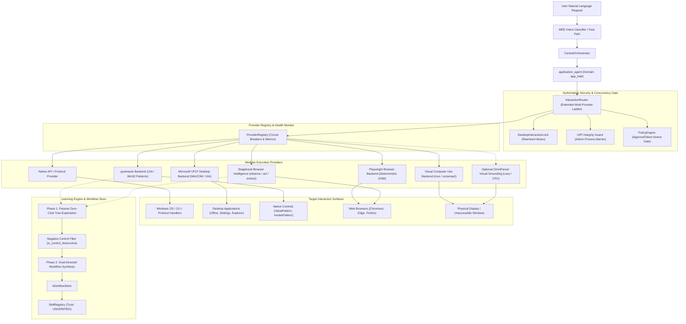

# OPTIMUS Milestone 18 — Advanced Execution Framework Integration
## Comprehensive Elephant Architecture Report

**Document ID:** EGM-M18-ARCH-001  
**Author:** Principal Windows Systems Architect & AI Systems Engineer  
**Milestone:** Milestone 18 — Advanced Execution Framework Integration  
**Repository:** `D:\project\srrr\Mark-LVII-main\Mark-LVII-main`  
**Date:** 2026-11-22  
**Target Environment:** Windows 11, Python 3.13.16, NVIDIA RTX 3050 (4 GB VRAM)  

---

### 1. Architectural Mission & Core Invariants

Milestone 18 enhances OPTIMUS M17 by integrating proven, industry-standard automation frameworks (**Microsoft UFO²**, **Playwright**, **Stagehand**, **pywinauto**, and **Microsoft OmniParser**) as modular execution providers under the authoritative supervision of the OPTIMUS application intelligence architecture.

#### Non-Negotiable Invariants:
1. **Single Orchestration Authority:** OPTIMUS `CentralOrchestrator` remains the sole authority for task decomposition, mission planning, agent delegation, and outcome verification. No external framework (including Microsoft UFO² `HostAgent`) shall act as an independent orchestrator or bypass OPTIMUS task planning.
2. **Authoritative Policy Gating:** All privileged operations (sending communications, modifying system files, executing scripts, purchasing, destructive actions) must strictly flow through `ToolRegistry.execute()` and evaluate `PolicyEngine` for single-use, cryptographically-bound `ApprovalToken` nonces. External frameworks are execution providers with zero autonomous approval authority.
3. **Desktop Focus & Concurrency Safety:** All physical desktop, mouse, keyboard, or window actuation across all providers must acquire `DesktopInteractionLock`. Reentrancy ownership stack (`_owner_stack`) must be strictly maintained to prevent focus races and keystroke interleaving.
4. **Untrusted Content Sandboxing:** All ingested UI labels, accessibility trees, web DOM structures, and extracted text must be enclosed in `<untrusted_external_content>` XML tags and marked using `core.outcome.untrusted()` to prevent prompt injection attacks.
5. **Two-Phase Learning Integrity:** Autonomous application learning remains bound by the strict Two-Phase boundary: Phase 1 Passive Zero-Click exploration, Phase 2 Active Goal-Directed synthesis with negative control filters (`is_control_destructive`). Synthesized workflows are persisted in `WorkflowStore` with initial `SkillTrustLevel.UNVERIFIED` and require explicit human review for promotion.
6. **Graceful Fallback & Circuit Breaking:** Providers must support health probes (`AVAILABLE`, `DEGRADED`, `UNAVAILABLE`), bounded execution timeouts (default 5.0s–30.0s), cancellation propagation, and atomic state rollback (`Esc`) upon failure.
7. **Hardware & Resource Protection:** Optional heavyweight models (such as OmniParser visual grounding) must be lazily loaded, support CPU fallback, and operate safely within the RTX 3050 4 GB VRAM ceiling (~2.4 GB available).

---

### 2. High-Level Architecture & Interaction Diagram



---

### 3. Detailed Framework Integration Architecture

#### 3.1 Microsoft UFO² Desktop Execution Backend
- **Repository Reference:** `https://github.com/microsoft/UFO`
- **Architectural Scope in OPTIMUS:**
  - In UFO², the architecture splits into `HostAgent` (system-level coordinator) and `AppAgent` (application-specific operator).
  - **Constraint:** We do NOT adopt `HostAgent` as a secondary orchestrator. `CentralOrchestrator` remains the sole coordinator.
  - We extract and integrate UFO²'s core strengths:
    1. **WinCOM Automation Bridge:** Direct OLE/COM automation for Microsoft Office (Word, Excel, PowerPoint) and system shells via `win32com.client` and `comtypes`, executing high-speed, invisible document manipulation without brittle GUI clicking.
    2. **Structured AppAgent Action Schemas:** Application-specific control models for Windows Settings, Explorer, Calculator, and Office apps.
    3. **Hybrid API + GUI Routing:** Selecting native COM APIs first, falling back to UIA patterns.
- **Provider Implementation:** `core/application_intelligence/frameworks/ufo/ufo_backend.py`.
- **Interface Contract:** Narrow, typed `UFODesktopBackend` implementing `BaseExecutionProvider`.

#### 3.2 Playwright Deterministic Browser Backend
- **Repository Reference:** `https://github.com/microsoft/playwright`
- **Architectural Scope in OPTIMUS:**
  - Provides reliable, deterministic web automation via the Chrome DevTools Protocol (CDP) and native browser drivers.
  - Core Responsibilities:
    1. **Tab & Context Lifecycle:** Launching or attaching to Chromium/Edge sessions via persistent browser context or CDP connection.
    2. **Deterministic Locators:** Text, role, CSS, and XPath locators with auto-wait semantics (`locator.click()`, `locator.fill()`, `locator.select_option()`).
    3. **File Handling & Downloads:** Streamed download interception with SHA-256 hash calculation and quarantine verification.
    4. **State Inspection:** Real DOM extraction, URL tracking, console error monitoring, and network request inspection.
- **Provider Implementation:** `core/application_intelligence/frameworks/browser/playwright_backend.py`.

#### 3.3 Stagehand Browser Intelligence
- **Repository Reference:** `https://github.com/browserbase/stagehand`
- **Architectural Scope in OPTIMUS:**
  - AI-assisted browser interaction layer built on top of Playwright.
  - Exposes three core primitives:
    1. `observe(instruction: str) -> list[StagehandObservation]`: Locates actionable elements matching natural-language user intent using DOM element tree filtering and visual attributes.
    2. `act(action: str) -> ExecutionEvidence`: Resolves user intent to a concrete Playwright action (click, type, navigate) and executes with auto-wait.
    3. `extract(instruction: str, schema: dict) -> dict[str, Any]`: Extracts structured data matching a schema from active web content.
  - **Security Rule:** All observed and extracted text is enclosed in `<untrusted_external_content>` tags.
- **Provider Implementation:** `core/application_intelligence/frameworks/browser/stagehand_intelligence.py`.

#### 3.4 pywinauto Native UIA & Win32 Backend
- **Repository Reference:** `https://github.com/pywinauto/pywinauto`
- **Architectural Scope in OPTIMUS:**
  - Evaluates both `uia` and `win32` backends against existing `core.screenview` / `core.screenact`.
  - Core Improvements over Raw Screenview:
    1. **Control Pattern Invocation:** Programmatic invocation of UIA control patterns (`ValuePattern.SetValue()`, `InvokePattern.Invoke()`, `TogglePattern.Toggle()`) which bypasses physical cursor movement and works on occluded or background controls.
    2. **Multi-Window & Menu Traversal:** Traversal of deep menu hierarchies (`File -> Export -> PNG`), context menus, and toolbars.
    3. **Thread/Process Isolation:** Wrapped in dedicated COM STA initialization (`comtypes.CoInitialize()` and `CoUninitialize()`) with 5.0s bounded execution timeouts.
- **Provider Implementation:** `core/application_intelligence/frameworks/pywinauto/pywinauto_backend.py`.

#### 3.5 Microsoft OmniParser Visual Grounding
- **Repository Reference:** `https://github.com/microsoft/OmniParser`
- **Architectural Scope in OPTIMUS:**
  - Optional, lazily-loaded visual grounding engine for non-accessible, canvas-rendered, or custom desktop applications where accessibility trees and UIA expose zero controls.
  - Core Evaluation Criteria & Guardrails:
    1. **Lazy Loading:** Model weights are never loaded into memory during standard OPTIMUS startup.
    2. **Hardware Constraints:** Must operate within RTX 3050 4 GB VRAM budget (~2.4 GB free) or fall back seamlessly to CPU execution / ONNX runtime.
    3. **Benchmarking:** CPU vs GPU latency, RAM/VRAM footprint, and bounding box grounding accuracy against standard vision and computer-use baselines.
- **Provider Implementation:** `core/application_intelligence/frameworks/omniparser/omniparser_grounding.py` and `benchmark.py`.

---

### 4. Modular Directory & Code Organization

```
core/application_intelligence/
├── __init__.py
├── types.py                                 # Extended with Framework Provider types
├── desktop_lock.py                          # Reentrant Mutex with _owner_stack
├── discovery.py                             # Multi-source Windows Discovery
├── registry.py                              # ApplicationRegistry Singleton
├── capabilities.py                          # Capability Descriptors & Heuristics
├── interaction_router.py                    # Extended with Multi-Provider Selection & Health Monitoring
├── learning_engine.py                       # Framework-Assisted Two-Phase Learning
├── workflow_store.py                        # Persisted Workflow Registry
├── adapters/                                # Native Application Adapters
│   ├── base.py
│   ├── whatsapp.py
│   ├── browser.py
│   ├── document.py
│   └── devtools.py
└── frameworks/                              # Advanced Execution Framework Integration (M18)
    ├── __init__.py
    ├── base.py                              # BaseExecutionProvider, ProviderHealthStatus, ExecutionRequest/Response
    ├── registry.py                          # ProviderRegistry singleton with circuit breaking & health probes
    ├── ufo/
    │   ├── __init__.py
    │   ├── ufo_backend.py                   # UFODesktopBackend implementation
    │   ├── app_agent_schemas.py             # Action schemas for Office, Settings, Explorer
    │   └── wincom_bridge.py                 # OLE/COM automation bridge
    ├── browser/
    │   ├── __init__.py
    │   ├── playwright_backend.py            # PlaywrightBrowserBackend (Deterministic DOM)
    │   └── stagehand_intelligence.py        # StagehandBrowserIntelligence (observe/act/extract)
    ├── pywinauto/
    │   ├── __init__.py
    │   ├── pywinauto_backend.py             # PywinautoExecutionBackend (UIA + Win32)
    │   └── control_patterns.py              # Pattern invokers (Value, Invoke, Selection)
    └── omniparser/
        ├── __init__.py
        ├── omniparser_grounding.py          # OmniParserVisualGrounding (Lazy-loaded)
        └── benchmark.py                     # Resource, VRAM, and latency benchmark harness
```

---

### 5. Multi-Factor Provider Selection Logic

`InteractionRouter` selects the optimal execution provider using a deterministic, multi-factor scoring function:

$$\text{Score}(P) = W_{\text{tier}} \cdot S_{\text{tier}} + W_{\text{rel}} \cdot R(P) - W_{\text{cost}} \cdot C(P) - W_{\text{lat}} \cdot L(P)$$

Where:
- $S_{\text{tier}}$: Priority weight of the interaction tier (Native/COM > Adapter > Deterministic DOM > UIA Pattern > Visual Actuation).
- $R(P)$: Historical reliability score of provider $P \in [0.0, 1.0]$.
- $C(P)$: Computational and resource cost (Local COM = 0, Playwright = 1, Visual Vision = 3, OmniParser = 5).
- $L(P)$: Expected latency in seconds.

**Provider Circuit Breaker:**
- If a provider encounters 3 consecutive timeouts or unhandled exceptions, its health state transitions from `AVAILABLE` to `DEGRADED` (penalized in scoring) or `UNAVAILABLE` (bypassed until health probe succeeds).

---

### 6. Acceptance Testing & Verification Matrix

The test suite in `tests/test_advanced_framework_integration.py` validates 15 comprehensive scenarios:

1. **UFO² Desktop Backend Initialization & Office COM Execution:** Verifies WinCOM bridge initializes Word/Excel/PowerPoint without UI clicking.
2. **UFO² Settings & Windows Shell Action Schemas:** Verifies structured action schema execution on Windows Settings and File Explorer.
3. **pywinauto Control Pattern Invocation:** Verifies `ValuePattern` text input and `InvokePattern` button click without mouse movement.
4. **pywinauto Deep Menu & Hierarchy Traversal:** Traverses multi-level menu bar (`File -> Options`) safely with COM STA isolation.
5. **Playwright Deterministic Navigation & Page State:** Verifies headed/headless Chromium session, locator auto-waiting, and state inspection.
6. **Playwright Download & Hash Verification:** Intercepts streamed file download, calculates SHA-256, and verifies quarantine.
7. **Stagehand Natural-Language Observe & Act:** Locates search bar via natural language intent and clicks search submit.
8. **Stagehand Schema Extraction:** Extracts structured table/data from active page matching a typed Pydantic schema.
9. **OmniParser Lazy Loading & VRAM Guard:** Confirms zero VRAM allocation at startup; benchmarks CPU vs GPU latency on RTX 3050.
10. **Multi-Factor Provider Selection & Routing:** Verifies `InteractionRouter` selects the optimal provider based on app type and capability.
11. **Provider Health Probe & Circuit Breaker:** Verifies degraded/failed providers are sidelined with atomic rollback (`Esc`).
12. **Framework-Assisted Application Learning:** Exercises Two-Phase learning using pywinauto control patterns and Stagehand DOM trees.
13. **PolicyEngine Cryptographic Gating Across Frameworks:** Verifies external frameworks cannot bypass approval token requirements.
14. **Indirect Prompt Injection Delimitation:** Confirms web and UI text from Playwright/Stagehand is wrapped in `<untrusted_external_content>`.
15. **End-to-End Workflow Execution & Verification:** Full multi-step task execution combining Playwright search, Document opening, and DevTools inspection.
