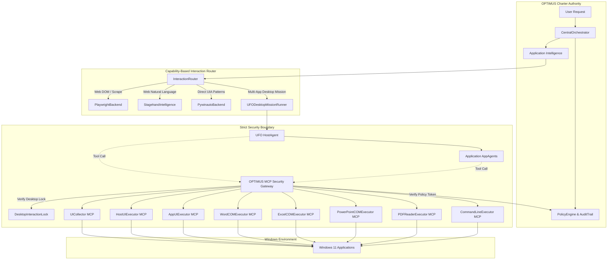

# OPTIMUS M19 — Full Microsoft UFO² Desktop Agent Integration Capability Gap Matrix

**Milestone:** M19 — Full Microsoft UFO² Desktop Agent Integration  
**Date:** 2026-11-22  
**Target Repository:** `D:\project\srrr\Mark-LVII-main\Mark-LVII-main`  
**Upstream UFO Repository:** `https://github.com/microsoft/UFO` (v2.0, cloned at `D:\project\ufo_upstream`)  

---

## 1. Executive Summary

Milestone M18 established narrow, typed execution contracts for WinCOM and basic AppAgent schemas while maintaining central orchestration authority. Milestone M19 expands this by integrating the **complete Microsoft UFO² runtime** (HostAgent, AppAgents, local MCP execution servers, state machines, application knowledge, and hybrid API/GUI interaction) as OPTIMUS's primary advanced Windows application execution subsystem.

This matrix analyzes the capability gaps between:
1. **Raw Upstream Microsoft UFO² (v2.0)**: Standalone, autonomous desktop agent runtime.
2. **Current OPTIMUS M18 Execution Subsystem**: Narrow execution providers behind `CentralOrchestrator`.
3. **M19 Integrated Target Architecture**: Delegated hierarchical orchestration with an authoritative security boundary and unified multi-provider routing.

---

## 2. Capability Gap & Invariant Matrix

| Dimension | Upstream UFO² v2.0 (Raw) | OPTIMUS M18 (Current) | M19 Target Integration | Risk / Gap Severity | Resolution Strategy |
|:---|:---|:---|:---|:---:|:---|
| **Orchestration Authority** | UFO controls top-level session loop (`Session` -> `HostAgent` -> `AppAgent`), making autonomous planning decisions. | `CentralOrchestrator` is sole planner; external frameworks are narrow stateless providers. | **Hierarchical Delegation**: `CentralOrchestrator` delegates bounded desktop missions to `UFOHostAgent`; HostAgent coordinates `AppAgents` *only* inside mission boundary. | **CRITICAL (CRIT-1)** | Encapsulate UFO session inside `UFODesktopMissionRunner`. HostAgent cannot expand task scope beyond delegated contract. |
| **MCP Execution Security** | MCP servers (`CommandLineExecutor`, `AppUIExecutor`, etc.) execute actions directly without permission checks or policy gates. | PolicyEngine checks tokens in `InteractionRouter` and in-provider defense-in-depth. | **Authoritative MCP Authorization Gateway**: All UFO MCP tools pass through `UFOMCPSecurityGateway` validating tokens, arguments, and targets. | **CRITICAL (CRIT-2)** | Wrap FastMCP tools in security decorators. Destructive/privileged tools require valid `ApprovalToken` from PolicyEngine. |
| **Prompt Injection Boundary** | UI text and web content ingested raw into LLM prompt context without demarcation. | Mandatory `core.outcome.untrusted("web", ...)` wrapper for web content. | **Universal UI/DOM Demarcation**: All screen text, window titles, OCR tokens, and extracted text wrapped in `untrusted("screen" / "web")`. | **CRITICAL (CRIT-3)** | Filter all `UICollector` text outputs through `core.outcome.untrusted` before returning to HostAgent or AppAgent prompts. |
| **Filesystem & Communication Boundaries** | MCP servers (`CommandLineExecutor`, `WordCOM`, `PDFReader`) access arbitrary paths and commands. | Strict workspace boundaries, UNC path rejection, exact-recipient message approvals. | **Boundary Enforcement**: Target paths validated against `UnifiedFilesystemService`; CLI commands filtered against strict allowlist. | **HIGH (HIGH-1)** | Reject UNC/sensitive directory access (`validate_path_not_sensitive`); enforce exact-match recipient approvals for WhatsApp. |
| **FastMCP & Dependency Compatibility** | Uses `fastmcp==2.11.3` with deprecated `exclude_args` parameter in tool decorators. | OPTIMUS environment uses `fastmcp>=4.2.4` where `exclude_args` raises `TypeError`. | **FastMCP 4.x Modernization**: Adapt MCP tool registration to FastMCP 4+ signatures without breaking tool contracts. | **HIGH (HIGH-2)** | Normalize MCP server registration and tool decorators; eliminate unsupported keyword arguments. |
| **Model & Inference Reusability** | Independent YAML configs (`system.yaml`, `prices.yaml`) hardcoding OpenAI/Azure endpoints. | Unified OPTIMUS LLM client supporting local Ollama (Qwen), Google GenAI, and cloud providers. | **Inference Bridge**: UFO agents route LLM calls through OPTIMUS inference provider pool, reusing local Ollama and configured keys. | **HIGH (HIGH-3)** | Implement `OptimusLLMAdapter` complying with UFO's `BaseLLM` interface, eliminating duplicate credential storage. |
| **Hardware Pre-flight & Resource Ceilings** | UFO visual mode captures high-res screenshots and invokes vision models indiscriminately. | M18 enforces $\ge 3.0$ GB free VRAM threshold on RTX 3050 Laptop GPU with ONNX/CPU fallback. | **Hardware Guarded Vision**: UFO visual grounding respects RTX 3050 VRAM limits; falls back to UIA tree or ONNX model (<150ms). | **HIGH (HIGH-4)** | Connect UFO visual prompters to `OmniParserBenchmark` pre-flight checks to prevent CUDA OOM. |
| **Workflow Learning & Provenance** | UFO saves experience trajectories to local JSON (`experience/`) without trust classification. | Workflows strictly saved as `UNVERIFIED` in `WorkflowStore` and registered at `SkillTrustLevel.UNVERIFIED`. | **Unified Workflow Provenance**: UFO trajectories transformed into OPTIMUS DAG workflows marked `UNVERIFIED` until human promotion. | **HIGH (HIGH-5)** | Connect UFO experience saver to `WorkflowStore.save_workflow(validation_state="UNVERIFIED")`. |
| **Concurrency & Desktop Lock** | UFO assumes sole ownership of mouse/keyboard input; multiple calls can interleave focus. | `DesktopInteractionLock` enforces reentrant thread-safe ownership stack with timeouts. | **Lock Integration**: UFO interactive steps acquire `DesktopInteractionLock`; non-interactive COM/headless calls run concurrently. | **MEDIUM (MED-1)** | Acquire lock during `AppUIExecutor` and `HostUIExecutor` actions; release immediately upon completion or rollback. |
| **Multi-Provider Execution Rationalization** | UFO attempts to handle all desktop, browser, and shell tasks uniformly. | Playwright handles browser DOM; Stagehand handles natural language web; pywinauto handles UIA. | **Capability-Based Router**: `InteractionRouter` routes to UFO for complex multi-app desktop flows, but retains Playwright for web DOM. | **MEDIUM (MED-2)** | Preserve M18 providers; UFO registered as `ufo_desktop_agent` tier; dispatch avoids redundant invocation. |
| **Failure Recovery & State Rollback** | UFO re-prompts LLM on failure, potentially repeating non-idempotent actions. | Bounded execution, single-use approval tokens, and polymorphic rollback. | **Idempotent Recovery**: Gateway tracks executed actions; prevents re-execution of non-idempotent operations on failure. | **MEDIUM (MED-3)** | Implement execution state journal in `UFODesktopMissionRunner` with rollback triggers on error. |

---

## 3. Component Architecture Comparison

---

## 4. Omission Rationale

The following upstream UFO² modules are intentionally excluded or heavily constrained in the OPTIMUS integration:

1. **Top-Level Standalone CLI Loop (`ufo.py` main CLI entry point)**:
   - *Rationale:* Redundant. OPTIMUS already has its own central CLI, Voice Interface, and PyQt6 Control Center. UFO must operate as a delegated subsystem, not a replacement front-end.
2. **Mobile/Android Session (`mobile_session.py`, `mobile_mcp_server.py`)**:
   - *Rationale:* Out of scope for Windows desktop assistant milestone. OPTIMUS M19 targets Windows 11 desktop automation.
3. **Linux Session (`linux_session.py`, `linux_mcp_server.py`)**:
   - *Rationale:* Incompatible with Windows 11 native runtime target.
4. **Experimental Picture-in-Picture (PiP) Virtual Desktop**:
   - *Rationale:* Upstream documentation notes PiP virtual display drivers require third-party kernel-mode driver installation and exhibit high crash rates on Windows 11 23H2/24H2. DesktopInteractionLock provides proven, stable synchronization without kernel drivers.
5. **Standalone API Server (`ufo/server/app.py` FastAPI server)**:
   - *Rationale:* In-process integration provides zero-overhead, direct Python object sharing and prevents unauthenticated network endpoints on localhost.
