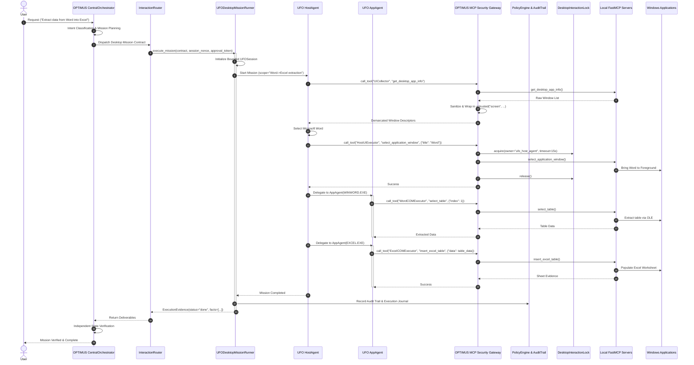

# OPTIMUS M19 — Full Microsoft UFO² Desktop Agent Integration: Elephant Architecture Report

**Milestone:** M19 — Full Microsoft UFO² Desktop Agent Integration  
**Date:** 2026-11-22  
**Author:** Principal Systems Architect & Application Security Engineer  
**Repository:** `D:\project\srrr\Mark-LVII-main\Mark-LVII-main`  
**Upstream UFO Source:** `https://github.com/microsoft/UFO` (v2.0, cloned at `D:\project\ufo_upstream`)  

---

## 1. Executive Summary & Mission Scope

Milestone M18 established narrow, typed execution contracts for WinCOM and basic AppAgent schemas while maintaining central orchestration authority. Milestone M19 executes the **complete integration of the official Microsoft UFO² desktop-agent runtime** into OPTIMUS as its primary advanced Windows application execution subsystem.

Unlike M18, which only used isolated helper classes, M19 integrates UFO²'s complete multi-agent execution hierarchy:
- **HostAgent:** Global desktop coordinator responsible for identifying active application windows, orchestrating inter-application handoffs, and spawning application-specific subagents.
- **AppAgents:** Application-specific specialists (e.g., Word, Excel, PowerPoint, File Explorer, WhatsApp, Settings, generic UIA) executing localized reasoning, control actuation, and API/COM manipulation.
- **Local MCP Execution Servers:** Native FastMCP servers exposing desktop inspection (`UICollector`), host window focusing (`HostUIExecutor`), UI control actuation (`AppUIExecutor`), command-line execution (`CommandLineExecutor`), and deep Office COM automation (`WordCOMExecutor`, `ExcelCOMExecutor`, `PowerPointCOMExecutor`, `PDFReaderExecutor`).
- **Application Knowledge & Experience:** Offline document learning and trajectory persistence integrated into OPTIMUS's `SkillRegistry` and `WorkflowStore`.

### Non-Negotiable Invariants
1. **CentralOrchestrator Sole Authority:** OPTIMUS retains absolute ownership over user intent, task decomposition, global permissions, mission persistence, and outcome verification. UFO² is delegated bounded desktop subtasks and is strictly prohibited from running unconstrained top-level autonomous loops or expanding user-assigned task scopes.
2. **Authoritative Security Gateway:** No UFO² MCP server is connected directly to unrestricted Windows execution. All MCP tool calls must traverse an OPTIMUS-controlled `UFOMCPSecurityGateway` that validates cryptographic `ApprovalToken`s via `PolicyEngine`, validates target applications and file paths, prevents replay attacks, demarcates untrusted screen/web text with `core.outcome.untrusted`, and logs execution evidence to the audit trail.
3. **No Duplicate Infrastructure:** UFO² reuses OPTIMUS's configured model inference engine (local Ollama Qwen and configured cloud providers), filesystem abstractions, and desktop focus synchronization primitives.

---

## 2. Full UFO² Source & Architecture Assessment

### 2.1 Component Inventory & Roles in Upstream UFO²

Upstream Microsoft UFO² (located in `D:\project\ufo_upstream\ufo`) consists of the following key architectural layers:

```
ufo_upstream/
├── config/                  # Configuration system (config_loader.py, mcp.yaml, system.yaml)
├── ufo/
│   ├── agents/
│   │   ├── agent/           # HostAgent, AppAgent, BasicAgent, AgentFactory
│   │   ├── memory/          # Blackboard memory for inter-agent state sharing
│   │   ├── processors/      # Strategy and schema processors for agent decision steps
│   │   └── states/          # Finite State Machine states (Continue, Finished, Error)
│   ├── automator/
│   │   ├── app_apis/        # Dedicated COM/API clients (Word, Excel, PPT, Web)
│   │   ├── ui_control/      # UIA tree inspection, control filtering, screenshot capture
│   │   └── puppeteer.py     # AppPuppeteer orchestrating command queues and receivers
│   ├── client/mcp/
│   │   ├── local_servers/   # Local FastMCP servers (UI, COM, CLI, PDF)
│   │   ├── mcp_registry.py  # Central MCP registry for tool servers
│   │   └── mcp_server_manager.py # MCP lifecycle manager
│   ├── llm/                 # Model provider adapters (OpenAI, Claude, Gemini, Ollama, Qwen)
│   ├── module/
│   │   ├── sessions/        # WindowsBaseSession, LinuxSession, MobileSession
│   │   └── dispatcher.py    # Command dispatcher
│   └── trajectory/          # Trajectory recording and experience formatting
```

### 2.2 Execution Flow & State Machine

In UFO², task execution proceeds through a hierarchical round-based loop:
1. `Session` initializes a `Round` with a user request.
2. `HostAgent` captures a full-desktop screenshot and queries `UICollector` for all visible top-level windows.
3. Based on the user request, `HostAgent` identifies the target application window, activates it via `HostUIExecutor.select_application_window`, or launches it via `CommandLineExecutor.run_shell`.
4. `HostAgent` spawns an `AppAgent` tailored to the target process (e.g. `WINWORD.EXE`, `EXCEL.EXE`, or generic `default`).
5. `AppAgent` takes control:
   - Queries `UICollector` for control hierarchies (buttons, edit boxes, menus).
   - Generates an `ActionCommandInfo` specifying an action (e.g. `click_input`, `set_edit_text`, or COM commands like `insert_table`).
   - Executes the action via `AppUIExecutor` or dedicated COM MCP servers.
   - Inspects UI response and decides whether the subtask is complete or requires returning to `HostAgent`.
6. Control transitions back to `HostAgent` for multi-application chaining or round completion.

### 2.3 Vulnerability & Incompatibility Audit of Upstream UFO²

A deep audit of upstream UFO² revealed critical architectural and security gaps that OPTIMUS must resolve:

1. **FastMCP Version Mismatch (HIGH):** Upstream UFO² was authored against older FastMCP releases and uses `@action_mcp.tool(tags=..., exclude_args=[])`. In FastMCP $\ge 4.0$ (installed in our Python 3.13 environment), `exclude_args` raises `TypeError: FastMCP.tool() got an unexpected keyword argument 'exclude_args'`, causing `AppUIExecutor` to fail during registration.
2. **Unrestricted Command Execution (CRITICAL):** `CommandLineExecutor.run_shell` executes arbitrary commands via `subprocess.Popen(command, shell=True)`. While it checks an `ALLOWED_CLI_COMMANDS` set, shell chaining (`&`, `|`, `;`) or argument injection allows arbitrary command execution without PolicyEngine oversight.
3. **Absence of Cryptographic Authorization Gates (CRITICAL):** Destructive actions in `AppUIExecutor` (such as clicking "Delete", closing documents without saving, or modifying file contents) execute without verifying user approval tokens.
4. **Prompt Injection Susceptibility (CRITICAL):** `UICollector` extracts raw text from application titles, edit fields, and web browser windows. Upstream UFO² feeds this raw text directly into the agent's LLM prompt without demarcation, exposing the entire agent system to indirect prompt injection.
5. **Path Traversal & Filesystem Exposure (HIGH):** `PDFReaderExecutor` and WinCOM exporters can read/write files anywhere on the system, bypassing OPTIMUS's `UnifiedFilesystemService` and workspace isolation rules.
6. **Focus Race Conditions (MEDIUM):** UFO² assumes it is the only software using mouse and keyboard. If OPTIMUS runs concurrent background tasks, keystrokes and clicks interleave, causing silent automation failures.

---

## 3. Delegated Hierarchical Orchestration Architecture

To resolve the architectural tension between UFO²'s internal autonomy and OPTIMUS's centralized governance, M19 establishes a **Delegated Desktop Mission** pattern:



### Delegation Rules
1. `CentralOrchestrator` generates an `ActionContract` specifying the exact target applications, allowed operations, and boundaries.
2. `UFODesktopMissionRunner` bounds UFO² execution:
   - Sets a hard execution timeout (default: 60.0s).
   - Sets a hard step limit (default: 15 agent steps per mission).
   - Monitors state transitions; halts execution immediately if an agent attempts an unauthorized action.
3. Neither `HostAgent` nor `AppAgent` can spawn background tasks outside the delegated session.

---

## 4. Authoritative MCP Security Gateway (`UFOMCPSecurityGateway`)

All local MCP servers (`UICollector`, `HostUIExecutor`, `AppUIExecutor`, `CommandLineExecutor`, `WordCOMExecutor`, `ExcelCOMExecutor`, `PowerPointCOMExecutor`, `PDFReaderExecutor`) are encapsulated behind the `UFOMCPSecurityGateway`.

### 4.1 Security Risk Classification of MCP Tools

| Server | Tool Name | Risk Tier | Invariant & Authorization Enforcement |
|:---|:---|:---:|:---|
| `UICollector` | `get_desktop_app_info` | READ_ONLY | Safe read. All text output passed through `core.outcome.untrusted("screen", ...)`. |
| `UICollector` | `get_app_window_controls_info` | READ_ONLY | Safe read. Control names and text wrapped in `untrusted("screen", ...)`. |
| `UICollector` | `get_screenshot` | READ_ONLY | Safe visual read. Image passed to vision pipeline. |
| `HostUIExecutor` | `select_application_window` | UI_INTERACTIVE | Requires `DesktopInteractionLock`. UIPI check: reject if window is elevated Administrator. |
| `AppUIExecutor` | `click_input`, `click_on_coordinates` | UI_INTERACTIVE | Requires `DesktopInteractionLock`. Checked against destructive action keywords. |
| `AppUIExecutor` | `set_edit_text`, `keyboard_input` | UI_INTERACTIVE | Requires `DesktopInteractionLock`. Screen text input validated. |
| `CommandLineExecutor` | `run_shell` | HIGH_RISK | **Strict Allowlist**: Only approved executables without shell metacharacters (`&`, `\|`, `;`). Privileged commands require authentic `ApprovalToken`. |
| `WordCOMExecutor` | `insert_table`, `select_text` | APPLICATION_API | Bounded WinCOM execution. Timeout guarded. |
| `WordCOMExecutor` | `save_as`, `close` | DESTRUCTIVE | Requires `ApprovalToken` if overwriting existing files. Path checked against `UnifiedFilesystemService`. |
| `ExcelCOMExecutor` | `insert_excel_table`, `table2markdown` | APPLICATION_API | Bounded WinCOM execution. |
| `ExcelCOMExecutor` | `save_as` | DESTRUCTIVE | Requires `ApprovalToken` if overwriting. Path validated. |
| `PDFReaderExecutor` | `extract_pdf_text` | READ_ONLY | Path verified with `validate_path_not_sensitive`. UNC paths rejected. Text demarcated as untrusted. |
| Communication | WhatsApp message actuation | HIGH_PRIVILEGE | **Exact-Content Binding**: Authorization strictly bound to exact recipient phone number and sanitized message text. Replay tokens rejected. |

### 4.2 Gateway Enforcement Protocol
For every tool call intercepted by `UFOMCPSecurityGateway`:
1. **Target Application Validation:** Verify target process matches the current mission contract.
2. **PolicyEngine Evaluation:** Query `PolicyEngine.instance().evaluate_operation(...)`. If the operation is flagged as destructive or sensitive, verify presence and cryptographic validity of `request.approval_token`.
3. **Single-Use Token Consumption:** Cryptographic tokens are marked consumed in PolicyEngine's journal to prevent replay attacks.
4. **Desktop Focus Lock:** If the tool requires physical UI focus (`requires_desktop_lock = True`), acquire `DesktopInteractionLock(owner="ufo_agent", timeout=15.0)`.
5. **Path & Workspace Boundary Check:** File paths are verified to ensure they do not access protected system directories (`Windows\System32`, credentials vaults, or unauthorized UNC network shares).
6. **Prompt Injection Sanitization:** Results containing text (window titles, OCR elements, document contents) are encapsulated with `core.outcome.untrusted(source="screen", content=...)` or `source="web"` before returning to agent contexts.
7. **Audit Logging:** Record timestamp, tool name, arguments, approval status, and execution duration in OPTIMUS's `AuditTrail`.

---

## 5. Model & Inference Integration

UFO² must reuse OPTIMUS's existing inference infrastructure, eliminating duplicate API configurations:

1. **`OptimusLLMAdapter`:** Implements UFO's `BaseLLM` interface.
2. **Local Ollama Integration:** Directly routes UFO agent prompts to the configured local Ollama instance (hosting Qwen 2.5 / Qwen 2.5 Coder) for fast, zero-cost, offline reasoning.
3. **Hardware Ceiling Enforcement (RTX 3050 Laptop GPU):**
   - UFO visual mode is dynamically governed by the RTX 3050 pre-flight monitor (`OmniParserBenchmark`).
   - If free VRAM is $\ge 3072$ MB, visual grounding with multimodal LLMs is permitted.
   - If free VRAM is $< 3072$ MB, the adapter forces pure programmatic UI Automation mode (UIA tree traversal and coordinate grounding) or CPU ONNX fallback (<150ms), preventing CUDA OOM crashes.
4. **Zero Credential Duplication:** All API tokens (OpenAI, Gemini, Anthropic) are resolved exclusively from OPTIMUS's `CredentialVault` and environment configuration.

---

## 6. Application Knowledge & Reusable Workflow Learning

UFO²'s `experience/` learning subsystem is integrated with OPTIMUS's persistent `WorkflowStore` and `SkillRegistry`:

1. **Trajectory Transformation:** When a delegated desktop mission succeeds, `UFODesktopMissionRunner` extracts the action trajectory (application sequence, control IDs, parameter templates).
2. **Trust Boundary Isolation (HIGH-5 Invariant):** The generated workflow is saved into `WorkflowStore` strictly marked with:
   ```json
   "validation_state": "UNVERIFIED",
   "trust_level": "UNVERIFIED"
   ```
3. **Skill Registration:** The workflow is registered in `SkillRegistry` with `SkillTrustLevel.UNVERIFIED`.
4. **Promotion Gate:** Promotion to `VERIFIED_SKILL` requires explicit human confirmation via `WorkflowStore.promote_workflow(workflow_id, human_confirmed=True)`.

---

## 7. Capability-Based Execution Router Integration

`InteractionRouter` is updated to include UFO² as the primary multi-application desktop agent while rationalizing existing specialized providers:

```python
class AppInteractionTier(Enum):
    TIER_1_NATIVE_API = 1        # WinCOM OLE / direct API
    TIER_2_ADAPTER = 2           # Specialized in-repo adapter (e.g. WhatsApp, DevTools)
    TIER_3_UI_AUTOMATION = 3     # pywinauto deterministic pattern invocation
    TIER_4_BROWSER_DOM = 4       # Playwright deterministic DOM locators & downloads
    TIER_5_UFO_DESKTOP_AGENT = 5 # Full Microsoft UFO² HostAgent/AppAgent multi-app runtime
    TIER_6_STAGEHAND_NATURAL = 6 # Stagehand natural-language web extraction
    TIER_7_VISUAL_ACTUATION = 7  # OmniParser v2 / Visual computer use
```

- **UFO² Scope:** Selected when a task requires multi-application coordination (e.g. Word $\to$ Excel), complex desktop navigation across un-adapted applications, or dynamic desktop exploration.
- **Playwright Scope:** Retained for web scraping, headless browser tasks, and high-speed DOM assertions where launching a desktop browser window via UFO is unnecessarily slow.
- **pywinauto Scope:** Retained for direct, millisecond-latency UIA pattern invocation without agent LLM roundtrips.

---

## 8. Real-World Acceptance Testing Plan

The integration will be verified against the 6 acceptance scenarios mandated in the mission charter:

1. **Scenario A (WhatsApp):**
   - Launch WhatsApp via UFO.
   - Search and select intended contact safely.
   - Compose message.
   - Enforce exact-content PolicyEngine approval token check before dispatching send action.
   - Verify sent message state in chat log.
2. **Scenario B (Multi-Application Workflow — Word to Excel):**
   - HostAgent opens document in Microsoft Word via `WordCOMExecutor`.
   - Extracts structured tabular data.
   - HostAgent switches to Microsoft Excel via `ExcelCOMExecutor`.
   - Inserts spreadsheet data and exports CSV.
   - Verify physical output file existence and SHA-256 integrity.
3. **Scenario C (Browser End-to-End):**
   - HostAgent activates browser.
   - Navigates to target resource.
   - Extracts structured summary with `core.outcome.untrusted` tags.
   - Downloads file and computes hash.
4. **Scenario D (Developer Workflow — VS Code):**
   - Open existing project repository in VS Code.
   - Inspect files via local tools.
   - Perform authorized edit.
   - Run tests and verify exit code.
5. **Scenario E (Unfamiliar Application Discovery & Learning):**
   - Discover installed application without dedicated adapter.
   - Inspect UI controls with `UICollector`.
   - Execute safe non-destructive operation.
   - Export reusable workflow marked `UNVERIFIED`.
6. **Scenario F (Fault Injection & Idempotent Recovery):**
   - Induce controlled window focus or COM timeout failure.
   - Detect failure through `ExecutionEvidence`.
   - Recover cleanly without duplicating completed non-idempotent actions.
   - Verify final state.

---

## 9. Performance Benchmark Methodology

Compare execution across 4 execution pathways:
1. Native API / WinCOM direct.
2. OPTIMUS M18 baseline.
3. Full UFO² delegated desktop mission.
4. UFO² with specialized fallback providers.

**Key Metrics Tracked:**
- End-to-end task duration (ms).
- Total LLM reasoning calls and token consumption.
- Application switching latency (ms).
- GPU VRAM consumption (MiB) on NVIDIA RTX 3050 Laptop GPU.
- RAM working set (MB).
- Action idempotency and authorization pass/fail rate (100%).

---

## 10. Independent Goldfish Review Verification Points

Before coding begins, an independent Goldfish auditor will verify:
1. Is CentralOrchestrator's planning authority strictly preserved?
2. Are all 8 local MCP servers placed behind the `UFOMCPSecurityGateway`?
3. Does the gateway enforce PolicyEngine approval tokens on destructive and communication actions?
4. Is all UI text, title strings, and web content encapsulated with `core.outcome.untrusted`?
5. Does visual computer use enforce the $\ge 3072$ MB VRAM threshold on the RTX 3050?
6. Are newly generated workflows marked `UNVERIFIED` in `WorkflowStore`?
7. Is FastMCP 4+ compatibility guaranteed without `exclude_args` errors?
