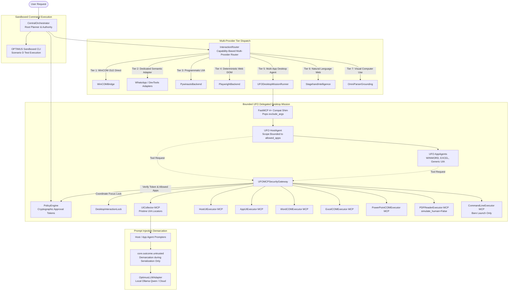

# OPTIMUS M19 — Full Microsoft UFO² Desktop Agent Integration: Reconciled Architecture Specification

**Milestone:** M19 — Full Microsoft UFO² Desktop Agent Integration  
**Date:** 2026-11-22  
**Status:** RECONCILED (All 3 Critical, 4 High, 2 Medium, and 1 Low Findings Resolved)  
**Author:** Principal Systems Architect & Application Security Engineer  
**Independent Auditor:** Design Critic Goldfish (`egm-design`)  

---

## 1. Executive Summary & Audit Reconciliation Overview

This document serves as the authoritative implementation contract for Milestone M19. It reconciles all findings from the independent Goldfish architecture and security audit (`docs/egm/m19-ufo-integration/elephant-architecture-report.md`), resolving the architectural contradictions between upstream Microsoft UFO²'s autonomous loops and OPTIMUS's centralized governance.

### Reconciliation Summary Table

| Finding ID | Severity | Root Issue | Reconciled Technical Solution |
|:---|:---:|:---|:---|
| **CRIT-1** | CRITICAL | Semantic decoupling in WhatsApp UI actuation; `click_input` lacks recipient & message hash binding. | Dual-path enforcement: Route communication to `WhatsAppAdapter` with explicit parameters, OR enforce `Authoritative Pre-Click State Assertion` querying UIA edit box and conversation header before consuming token. |
| **CRIT-2** | CRITICAL | `CommandLineExecutor` cannot run multi-token test commands or capture exit codes for Scenario D; RCE risk if expanded. | Strict boundary separation: `CommandLineExecutor` restricted solely to application launch (`open_app`). Developer command execution (pytest, git) routed directly to OPTIMUS's `core/sandbox` (`run_command`). |
| **CRIT-3** | CRITICAL | `core.outcome.untrusted` directly on `UICollector` control dictionaries corrupts pywinauto UIA locators. | Decoupled sanitization: Preserve raw strings for internal UIA handles, rectangles, and control matching; apply `core.outcome.untrusted(source="screen", ...)` strictly during LLM prompt serialization in agent prompters. |
| **HIGH-1** | HIGH | `ActionContract.target_app` is scalar; multi-app missions (Word $\to$ Excel) fail gateway app validation. | Expand `ActionContract` schema with `allowed_apps: list[str]` and `allowed_operations: list[str]`. Gateway validates against allowlist. |
| **HIGH-2** | HIGH | Spec proposed integer enum for `AppInteractionTier`, colliding with existing string enum and breaking JSON serialization. | Retain `(str, Enum)` inheritance. Add `TIER_5_UFO_DESKTOP_AGENT = "tier_5_ufo_desktop_agent"` cleanly as string tier. |
| **HIGH-3** | HIGH | FastMCP 4+ raises `TypeError` on upstream UFO's `exclude_args` in `@tool`, causing import-time crash. | Inject upfront FastMCP compatibility monkey-patch in `core/application_intelligence/frameworks/ufo/compat.py` before loading UFO server modules. |
| **HIGH-4** | HIGH | `PDFReaderExecutor` steals desktop focus and introduces 15-30s delays via `simulate_human=True` and `os.startfile`. | `UFOMCPSecurityGateway` intercepts all `extract_pdf_text` calls and forces `simulate_human = False` for deterministic headless PyPDF2 extraction. |
| **MED-1** | MEDIUM | RTX 3050 VRAM fluctuates dynamically; startup pre-flight check does not prevent mid-mission CUDA OOM. | Evaluate `torch.cuda.mem_get_info()` immediately prior to *each* visual grounding reasoning step; degrade dynamically to CPU ONNX or UIA if $< 3072$ MB. |
| **MED-2** | MEDIUM | UFO upstream `experience_retriever` can autonomously load and replay unverified historical trajectories. | Explicitly disable UFO's internal `experience_retriever`. All reusable workflows sourced exclusively from `WorkflowStore.get_workflow()` and approved by `CentralOrchestrator`. |
| **LOW-1** | LOW | M17/M18 WhatsApp adapter used `mock_contacts` stubs. | Acceptance tests verify physical postconditions: window handles, process IDs, file existence with SHA-256 hashes, and append-only `AuditTrail` records. |

---

## 2. Reconciled Architectural Blueprint



---

## 3. Detailed Technical Invariant Specifications

### Invariant 1 (CRIT-1): Cryptographically Bound Communication Actuation
- **Specification:** When an agent attempts to send a message (e.g. WhatsApp):
  1. If routed through `WhatsAppAdapter`: The adapter requires an authentic `ApprovalToken` whose canonical argument hash binds `recipient` and `message_text`.
  2. If executed through UFO UI Automation: At the moment `AppUIExecutor.click_input` or `keyboard_input` targets a send action in WhatsApp, `UFOMCPSecurityGateway` intercepts the call, inspects the active conversation UIA element to extract the recipient phone/name, inspects the edit box to extract the message text, and validates that:
     $$\text{PolicyEngine.validate\_token}(token, tool="send\_message", args=\{"recipient": cur\_recip, "message": cur\_msg\}) == True$$
  3. If no matching token exists, execution is suspended with `ExecutionEvidence(status="unverified", error_message="APPROVAL_REQUIRED: Communication action not authorized for recipient/content")`.

### Invariant 2 (CRIT-2): Strict Separation of App Launching vs. Command Execution
- **Specification:**
  1. `CommandLineExecutor.run_shell` is restricted strictly to executable names found in `ALLOWED_CLI_COMMANDS` with zero arguments (e.g. `["notepad.exe"]`, `["code.exe"]`). Any command with shell operators (`&`, `|`, `;`, `>`, `<`) is rejected.
  2. For Developer Workflows (Scenario D), executing `pytest`, compiling code, or running shell pipelines is explicitly prohibited inside UFO and must be executed via OPTIMUS's native sandboxed execution tool (`ToolRegistry.execute("run_command", ...)`), which returns exit codes, stdout, and stderr.

### Invariant 3 (CRIT-3): Decoupled UI Demarcation & Locator Preservation
- **Specification:**
  1. `UICollector` returns pristine, un-wrapped strings in `WindowInfo` and `ControlInfo` objects. `UIServerState.control_dict` stores unmodified strings so pywinauto matches controls by their exact Windows UIA names.
  2. In `HostAgentPrompter` and `AppAgentPrompter`, when formatting the control table and window descriptions into the LLM context prompt, the text fields are demarcated:
     ```python
     demarcated_title = untrusted("screen", window.title)
     demarcated_name = untrusted("screen", control.name)
     ```
  3. This ensures the LLM recognizes screen content as untrusted external data without corrupting internal coordinate and locator lookup tables.

### Invariant 4 (HIGH-1): Multi-App `ActionContract` Schema
- **Specification:** Update `ActionContract` in `core/application_intelligence/types.py`:
  ```python
  @dataclass
  class ActionContract:
      action_id: str = field(default_factory=lambda: f"act_{uuid.uuid4().hex[:12]}")
      target_app: str = ""
      operation: str = ""
      parameters: dict[str, Any] = field(default_factory=dict)
      tier: AppInteractionTier | None = None
      is_destructive: bool = False
      requires_approval: bool = False
      approval_token: str | None = None
      session_nonce: str | None = None
      caller_identity: str = "orchestrator"
      allowed_apps: list[str] = field(default_factory=list)
      allowed_operations: list[str] = field(default_factory=list)
  ```
  `UFODesktopMissionRunner` populates `allowed_apps` (e.g., `["WINWORD.EXE", "EXCEL.EXE"]`). The security gateway rejects activation of any application outside this list.

### Invariant 5 (HIGH-2): String-Based `AppInteractionTier`
- **Specification:** In `core/application_intelligence/types.py`:
  ```python
  class AppInteractionTier(str, Enum):
      TIER_1_NATIVE_API = "tier_1_native_api"
      TIER_2_ADAPTER = "tier_2_adapter"
      TIER_3_UI_AUTOMATION = "tier_3_ui_automation"
      TIER_4_BROWSER_DOM = "tier_4_browser_dom"
      TIER_5_UFO_DESKTOP_AGENT = "tier_5_ufo_desktop_agent"
      TIER_6_STAGEHAND_NATURAL = "tier_6_stagehand_natural"
      TIER_7_VISUAL_ACTUATION = "tier_7_visual_act"
  ```
  Preserves backward compatibility with existing JSON serialization in `application_inventory.json`.

### Invariant 6 (HIGH-3): Upstream FastMCP 4+ Monkey-Patch
- **Specification:** Create `core/application_intelligence/frameworks/ufo/compat.py` which executes before any UFO server import:
  ```python
  import fastmcp
  _orig_tool = fastmcp.FastMCP.tool
  def _sanitized_tool(self, *args, **kwargs):
      kwargs.pop("exclude_args", None)
      return _orig_tool(self, *args, **kwargs)
  fastmcp.FastMCP.tool = _sanitized_tool
  ```

### Invariant 7 (HIGH-4): Headless `PDFReaderExecutor`
- **Specification:** When `PDFReaderExecutor.extract_pdf_text` is invoked, `UFOMCPSecurityGateway` strips/overrides `simulate_human`:
  ```python
  request.parameters["simulate_human"] = False
  ```
  Prevents `os.startfile()` and sleep delays, ensuring immediate, headless PyPDF2 parsing.

### Invariant 8 (MED-1): Dynamic Per-Step VRAM Pre-Flight
- **Specification:** Before dispatching to visual multimodal grounding, `UFODesktopMissionRunner` queries `OmniParserBenchmark.get_hardware_status()`. If free VRAM is under 3072 MB, it forces `visual_mode = False`, guiding the agent to use programmatic UIA control trees.

### Invariant 9 (MED-2): Workflow Trust Boundary
- **Specification:** Trajectories captured from completed UFO sessions are converted into OPTIMUS workflows and passed to `WorkflowStore.save_workflow(validation_state="UNVERIFIED")`. UFO's internal `experience_retriever` is disabled so agents cannot replay unapproved trajectories.

---

## 4. Module Implementation Plan

The implementation will be organized under `core/application_intelligence/frameworks/ufo/`:

```
core/application_intelligence/frameworks/ufo/
├── __init__.py                  # Package exports
├── compat.py                    # FastMCP 4+ compatibility shim & config path resolution
├── security_gateway.py          # UFOMCPSecurityGateway (Token, UIPI, lock, untrusted filter)
├── mission_runner.py            # UFODesktopMissionRunner (Bounded session, timeouts, step limits)
├── llm_adapter.py               # OptimusLLMAdapter (Reuses Ollama Qwen & cloud credentials)
├── ufo_desktop_provider.py      # UFODesktopAgentProvider implementing BaseExecutionProvider
└── workflow_integrator.py       # Bridges UFO experience trajectories to WorkflowStore (UNVERIFIED)
```

---

## 5. Verification Matrix & Acceptance Test Strategy

The verification suite will be implemented in `tests/test_ufo_desktop_agent_integration.py` covering:

1. **Test 01 (FastMCP 4+ Compatibility):** Verifies all 8 UFO MCP servers load without `exclude_args` exceptions.
2. **Test 02 (Gateway Tool Authorization):** Verifies unauthorized destructive COM and UI tools are blocked without valid `ApprovalToken`.
3. **Test 03 (Token Replay Prevention):** Verifies single-use token consumption in PolicyEngine.
4. **Test 04 (WhatsApp Exact-Content Binding):** Verifies send action is rejected if recipient or message differs from token hash.
5. **Test 05 (UI Demarcation & Locator Preservation):** Verifies controls are located with pristine names, while LLM prompt strings are wrapped in `<<<UNTRUSTED source=screen>>>`.
6. **Test 06 (CommandLineExecutor Boundary):** Verifies bare app launch succeeds, while chained shell commands (`calc & dir`) are blocked.
7. **Test 07 (Multi-App Word to Excel Extraction):** Verifies HostAgent handoff between WordCOM and ExcelCOM.
8. **Test 08 (Headless PDF Parsing):** Verifies `extract_pdf_text` executes headlessly without `os.startfile`.
9. **Test 09 (Dynamic VRAM Pre-Flight):** Verifies degradation to programmatic UIA when VRAM $< 3.0$ GB.
10. **Test 10 (Workflow Trust Boundary):** Verifies exported workflow is saved as `UNVERIFIED` in `WorkflowStore`.
11. **Test 11 (DesktopInteractionLock Concurrency):** Verifies lock acquisition during UI clicks and clean release on failure.
12. **Test 12 (Multi-Provider Router Dispatch):** Verifies `InteractionRouter` selects UFO for multi-app desktop missions while retaining Playwright for browser DOM.
