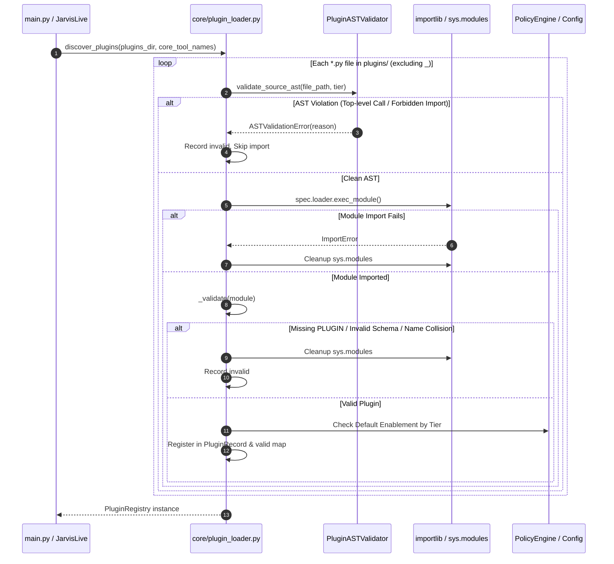

# OPTIMUS Plugin System (M20) — Reconciled Architecture Specification

**Author:** Principal Systems Architect & Security Engineer (Elephant)  
**Auditor:** Independent Goldfish Security Critic  
**Date:** 2026-11-22  
**Target Repository:** `D:\project\srrr\Mark-LVII-main\Mark-LVII-main`  
**Branch:** `main`  
**Status:** **RECONCILED & APPROVED FOR IMPLEMENTATION**

---

## 1. Executive Summary & Resolution Matrix

This specification reconciles all architectural and security findings identified during the Elephant Investigation and the Independent Goldfish Audit. It establishes a robust, secure, and fail-closed plugin lifecycle for OPTIMUS.

| Finding | Category | Title | Resolution Strategy |
|:---|:---|:---|:---|
| **CRT-01** | Security | Token Double-Consumption | Added `pre_authorized: bool = False` flag to `PluginRegistry.run()`. If invoked via `ToolRegistry.execute()`, redundant PolicyEngine evaluation and nonce consumption are skipped. |
| **CRT-02** | Security | AST Whitelist Linting Gate | Implemented `PluginASTValidator` strictly enforcing top-level node whitelisting: zero top-level `Call` nodes permitted, and import restrictions on dangerous modules (`subprocess`, `ctypes`, `pty`, `multiprocessing`) for non-execution tiers. |
| **CRT-03** | Security | Tiered Activation Model | Modified `get_plugin_enabled()`: elevated capability tiers (`WORKSPACE_WRITE`, `NETWORK_EXTERNAL`, `EXECUTION`, `SYSTEM_MUTATING`) default to disabled until explicitly enabled in `config/api_keys.json` or via HUD. |
| **HIGH-01** | Security | GUI Action Callback Hardening | Hardened `PluginSettingsOverlay._run_action` with 10.0s timeout and exception secret redaction via `_SECRET_PATTERNS`. |
| **HIGH-02** | Architecture | CapabilityTier Alignment | Standardized `PLUGIN["tier"]` to strictly require valid `CapabilityTier` enum string (e.g. `READ_ONLY`, `EXECUTION`). Defaults to `READ_ONLY`. |
| **HIGH-03** | Stability | Execution Timeout Budget | Implemented 30.0s timeout budget in `PluginRegistry.run()` using thread pool execution to prevent worker thread starvation. |
| **HIGH-04** | Runtime | Module Cache Cleanup | Enforced immediate `sys.modules.pop(module_name, None)` in `discover_plugins()` whenever validation or collision checks fail. |
| **MED-01** | Isolation | Namespace Separation | Enforced `namespace` validation in `save_plugin_config`: must match plugin name or start with `plugin_`, strictly blocking root key overwrite. |
| **MED-02** | Collisions | ToolRegistry Collision Check | Updated `main.py` to union `_inline_names`, `_action_registry.names()`, and `ToolRegistry.instance()._tools.keys()` into `core_tool_names`. |
| **MED-03** | Security | Untrusted Output Demarcation | Wrapped model return values with `outcome.untrusted(source=f"plugin:{name}", content=result)` while keeping UI transcripts clean via `outcome.unwrap()`. |

---

## 2. Core Architecture & Lifecycles

### 2.1 Plugin Discovery Pipeline



---

## 3. Data Contracts & Component Specifications

### 3.1 Plugin Definition Schema (`PLUGIN`)
Every plugin in `plugins/<name>.py` must declare a top-level `PLUGIN` dictionary:

```python
PLUGIN = {
    "name": "acceptance_test_plugin",                     # Identifier: ^[a-zA-Z_][a-zA-Z0-9_]{0,63}$
    "version": "1.0.0",                                   # Semantic version string
    "description": "Deterministic test plugin verifying security and lifecycle.",
    "tier": "READ_ONLY",                                  # Must be a valid CapabilityTier enum string
    "capabilities": ["test", "math", "settings:read"],    # Audit metadata tags
    "behavior": "BLOCKING",                               # Optional: BLOCKING | NON_BLOCKING
    "scheduling": "WHEN_IDLE",                            # Optional: WHEN_IDLE | SILENT | INTERRUPT
    "parameters": {
        "type": "OBJECT",
        "properties": {
            "action": {"type": "STRING", "enum": ["health", "calculate", "error", "get_setting"]},
            "a": {"type": "NUMBER"},
            "b": {"type": "NUMBER"},
            "operator": {"type": "STRING"},
        },
        "required": ["action"],
    },
}
```

### 3.2 AST Validator Rules (`PluginASTValidator`)
Before `exec_module()` is invoked:
1. Parse source code using `ast.parse()`.
2. Inspect `ast.Module.body`:
   - Permitted node types: `Import`, `ImportFrom`, `FunctionDef`, `AsyncFunctionDef`, `ClassDef`, `Assign`, `AnnAssign`, and docstring `Expr(Constant(str))`.
   - **Forbidden node types:** Any `Call` node at the module root level (e.g. `func()`, `init()`, `os.system()`).
3. Check imports:
   - For plugins declaring `tier == "READ_ONLY"` or missing tier: imports of `subprocess`, `ctypes`, `pty`, `multiprocessing` are rejected with `ASTSecurityViolation`.

### 3.3 Dynamic Dispatch & Single-Token Consumption
In `core/plugin_loader.py`:
```python
def run(self, name: str, parameters: dict, player=None, session_memory=None,
        pre_authorized: bool = False, approval_token: str | None = None) -> str:
    rec = self._plugins.get(name)
    if rec is None or not rec.valid:
        return f"Plugin '{name}' is not available."
    if not get_plugin_enabled(name):
        return f"The '{name}' plugin is currently disabled."

    # 1. Authoritative PolicyEngine Evaluation (Unless Pre-Authorized by ToolRegistry)
    if not pre_authorized:
        pe = PolicyEngine.instance()
        token_obj = pe.get_token(approval_token) if approval_token else None
        verdict = pe.evaluate_operation(OperationRequest(
            tool_name=f"plugin.{name}",
            agent_name="plugin_runner",
            arguments=parameters,
            allowed_tiers=[CapabilityTier(rec.tier)],
            approval_token=token_obj,
        ))
        if verdict.requires_approval or not verdict.is_authorized:
            return f"APPROVAL_REQUIRED: Plugin '{name}' execution not authorized: {verdict.reason}"

    # 2. Timeout-Bounded Execution
    start_time = time.monotonic()
    try:
        with concurrent.futures.ThreadPoolExecutor(max_workers=1) as executor:
            future = executor.submit(_call_run, rec.run, parameters, player, session_memory)
            result = future.result(timeout=rec.timeout or 30.0)
            return str(result or "Done.")
    except concurrent.futures.TimeoutError:
        msg = f"Sir, the '{name}' plugin timed out after 30 seconds."
        self._logger(msg)
        return msg
    except Exception as e:
        sanitized_error = self.sanitize_secrets(str(e))
        self._logger(f"Plugin '{name}' crashed: {sanitized_error}")
        return f"Sir, the '{name}' plugin failed: {sanitized_error}"
```

### 3.4 Secret Redaction Sanitizer
In `PluginRegistry.sanitize_secrets(text: str) -> str`:
Applies OPTIMUS regex redactions:
- API Keys: `sk-[a-zA-Z0-9_\-]{20,}` -> `[REDACTED_API_KEY]`
- GitHub Tokens: `ghp_[a-zA-Z0-9]{36,}` -> `[REDACTED_TOKEN]`
- Bearer Tokens: `Bearer\s+[a-zA-Z0-9_\-\.]{20,}` -> `Bearer [REDACTED_TOKEN]`
- Password/Secret Fields: `(['"]?(?:password|passwd|secret|api_?key)['"]?\s*[:=]\s*['"])[^'"]+(['"])` -> `\1[REDACTED]\2`

---

## 4. Harmless Acceptance-Test Plugin Specification

`plugins/acceptance_test_plugin.py`:
- **Name:** `acceptance_test_plugin`
- **Tier:** `READ_ONLY`
- **Actions:**
  - `health`: Returns `{"status": "ok", "version": "1.0.0", "engine": "OPTIMUS"}`
  - `calculate`: Calculates `a + b` or `a * b` based on `operator`
  - `get_setting`: Reads `test_threshold` from `plugin_config["acceptance_test_plugin"]`
  - `trigger_error`: Raises `RuntimeError("Connection failed with key sk-live-1234567890abcdef1234567890")` to verify secret redaction
- **Settings (`PLUGIN_SETTINGS`):**
  - Namespace: `acceptance_test_plugin`
  - Fields:
    - `test_threshold`: Integer (default: 100)
    - `test_api_key`: Secret (default: "")
  - Action: `test_connection` -> returns `{"ok": True, "message": "Connection verified"}`

---

## 5. Live Acceptance Testing Matrix

| Test Group | Test Scenario | Execution Method | Expected Result |
|:---|:---|:---|:---|
| **A. Discovery** | Harmless plugin discovery | Boot / `discover_plugins()` | Discovered, valid, metadata matches schema |
| **A. Discovery** | Malformed / Bad AST plugin | Synthesize plugin with top-level `os.system()` | Rejected by AST validator, zero execution, status `BROKEN` |
| **A. Discovery** | Collision with core tool | Synthesize plugin with name `calculator` | Rejected with collision error, core tool preserved |
| **B. Execution** | Health check dispatch | `PluginRegistry.run()` | Returns deterministic success string |
| **B. Execution** | Deterministic calculation | `PluginRegistry.run()` | Returns correct arithmetic result |
| **C. Config** | Update setting in memory & disk | `save_plugin_config` | Value persists in `config/api_keys.json` under namespace |
| **C. Config** | Persistence across reload | Re-read config after save | `get_plugin_config` returns exact saved value |
| **D. Lifecycle** | Disable plugin | `save_plugin_enabled(name, False)` | Excluded from tool declarations, invocation rejected |
| **D. Lifecycle** | Re-enable plugin | `save_plugin_enabled(name, True)` | Restored to tool declarations, execution succeeds |
| **E. Errors** | Controlled error trigger | Invoke `trigger_error` | Contained, returns clean error, OPTIMUS unaffected |
| **E. Errors** | Secret redaction in error | Error contains `sk-live-...` | Output speaks `[REDACTED_API_KEY]`, secret never leaked |
| **F. Security** | PolicyEngine evaluation | Operation exceeding tier | Blocked by PolicyEngine or challenged for approval |
| **G. UI Overlay**| PluginManager & Settings HUD | Overlay initialization & render | Valid widgets render, toggles function, forms populate |

---

## 6. Implementation Plan & File Touch-Points

1. `core/plugin_loader.py`:
   - Add `PluginASTValidator` (top-level AST whitelist & dangerous import prevention).
   - Add `CapabilityTier` validation to `_validate()`.
   - Update `PluginRegistry.run()` with `pre_authorized`, timeout (30s), secret sanitization, and `sys.modules` cleanup.
   - Update `discover_plugins()` with AST pre-screening and cache cleanup.
2. `memory/config_manager.py`:
   - Update `get_plugin_enabled()`: elevated tiers default to disabled.
   - Update `save_plugin_config()`: enforce namespace safety check.
3. `main.py`:
   - Include `ToolRegistry.instance()._tools.keys()` in `core_tool_names`.
   - Wrap plugin return text with `outcome.untrusted()` for model response and `outcome.unwrap()` for transcripts.
4. `gui/overlays.py`:
   - Hardened `PluginSettingsOverlay._run_action` with timeout and secret sanitization.
5. `plugins/acceptance_test_plugin.py`:
   - Create canonical harmless acceptance test plugin.
6. `tests/test_plugin_loader.py`:
   - Automated pytest suite with comprehensive lifecycle and security coverage.

All conditions are resolved. Proceed directly to implementation.
